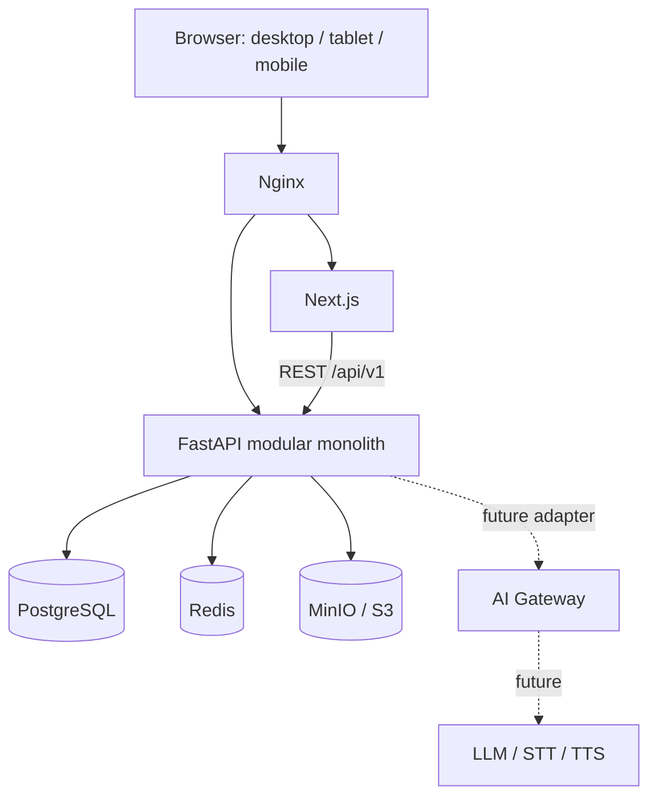
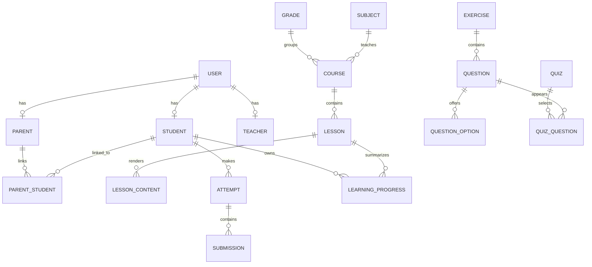
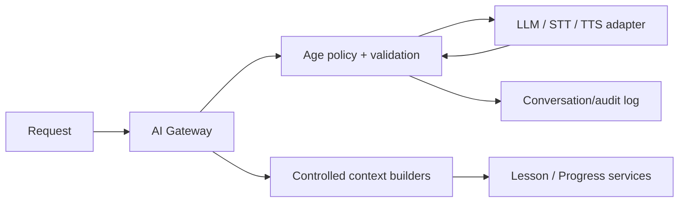

# VietTree Education

Tài liệu kiến trúc kỹ thuật cho nền tảng học tập dành cho học sinh tiểu học Việt Nam. MVP ưu tiên lớp 1–2, với Toán, Tiếng Việt và Tiếng Anh.

> **Nguyên tắc:** simple now, extensible later. MVP là modular monolith, không phải microservices.

## 1. Product overview

VietTree cung cấp bài học theo các khối nội dung, bài tập, quiz, theo dõi tiến độ và gamification. Giao diện phải trực quan, nhiều phản hồi tức thì, an toàn và dễ dùng trên điện thoại, tablet lẫn desktop.

### Goals

- Học sinh đăng nhập, học, làm bài/quiz, xem kết quả và tiến độ.
- Phụ huynh liên kết con và xem dữ liệu học cơ bản.
- Admin quản trị người dùng và nội dung.
- Nội dung được quản lý bằng dữ liệu/API, không hard-code trong frontend.
- Tạo ranh giới domain rõ để mở rộng AI sau này.

### Non-goals MVP

- AI tutor, LLM, STT/TTS, đánh giá phát âm, recommendation ML.
- Microservices, Kubernetes, Kafka, Milvus/vector DB hoặc vLLM.
- Teacher authoring/classroom hoàn chỉnh, thanh toán, realtime classroom.

## 2. User roles

| Role | Khả năng |
| --- | --- |
| Student | Học bài, làm bài/quiz, xem kết quả/tiến độ, XP, stars, badge, streak. |
| Parent | Liên kết trẻ đã xác nhận; chỉ xem thời gian học, điểm, tiến độ, điểm mạnh/yếu, gợi ý. |
| Teacher | Điểm mở rộng: tạo nội dung, quản lý lớp, xem hiệu quả học tập. MVP có thể giới hạn read-only. |
| Admin | Quản trị người dùng, môn, khối, course, lesson, exercise, quiz, cấu hình. |

Backend luôn là nguồn chân lý cho authorization. Frontend guard chỉ giúp điều hướng. Student, Parent và Teacher đều là profile 1:1 của `User`; Admin là role của `User`.

## 3. System architecture



Nginx là điểm vào production: `/` tới Next.js, `/api/` tới FastAPI. PostgreSQL là source of truth; Redis là cache/temporary state; MinIO chứa binary. Mỗi module FastAPI có router, schema, service và repository riêng, nhưng vẫn deploy cùng một application/database.

### Architecture decisions & trade-offs

- **Modular monolith:** ít vận hành, transaction đơn giản, phát triển MVP nhanh. Chỉ tách service khi có độc lập về ownership, scale hoặc release cadence.
- **REST/OpenAPI:** FastAPI tự tạo `/docs`, phù hợp web client và admin CRUD.
- **Relational core:** learning data cần foreign key, constraint và reporting; JSONB chỉ cho cấu hình linh hoạt.
- **UUID primary keys:** không lộ ID tuần tự, dễ mở rộng multi-service sau này.
- **Server-side scoring:** client không bao giờ quyết định đáp án hoặc XP.

## 4. Backend architecture

```text
backend/
├── app/
│   ├── main.py                    # app, middleware, router registration
│   ├── core/                      # config, database, security, logging, exceptions
│   ├── api/v1/router.py           # versioned router composition
│   ├── models/                    # SQLAlchemy models/enums
│   └── modules/
│       ├── auth/ users/ students/ parents/ teachers/
│       ├── subjects/ grades/ courses/ lessons/ exercises/ quizzes/
│       ├── attempts/ progress/ gamification/ files/ ai/
│       └── <module>/{router,schemas,service,repository}.py
├── alembic/                        # database migrations
└── tests/                          # unit, integration, authorization tests
```

- `router`: HTTP status, dependency injection, request/response.
- `schemas`: Pydantic contracts; không trả secret/correct answer.
- `service`: use cases, domain rule và transaction boundary.
- `repository`: query/persistence; không chứa authorization policy.
- `models`: ánh xạ bảng; `core` không biết logic học tập.

Không tạo abstraction trống. Mutation chấm bài thực hiện một transaction: ghi submissions → attempt → progress → XP ledger. Retry được chống cấp thưởng trùng bằng idempotency key.

## 5. Database architecture

Mọi bảng dùng `id UUID`, `created_at`, `updated_at`. Nội dung có thể dùng `deleted_at` để soft-delete; record attempt/submission không xóa vì là lịch sử. Các FK được index; `created_by`/`updated_by` dùng cho content audit.

| Entity | Mục đích và constraint/lifecycle |
| --- | --- |
| User | Identity: email/phone, password hash, role, status. Email unique case-insensitive. |
| Student / Parent / Teacher | Profile 1:1 với User; Student giữ `grade_id`, total XP, stars, level, streak. |
| ParentStudent | Liên kết parent–student, unique `(parent_id, student_id)`, trạng thái verified. |
| Grade | Lớp 1–5; code unique. Không xóa nếu đang được tham chiếu. |
| Subject | Môn học; code unique, active flag. |
| Course | Theo Subject + Grade; `draft/published/archived`, thứ tự. |
| Lesson | Đơn vị học thuộc Course; `position` unique trong course; publish trước khi hiện cho student. |
| LessonContent | Block sắp thứ tự của Lesson: `block_type`, `position`, `data JSONB`; unique `(lesson_id, position)`. |
| Exercise | Nhóm câu hỏi, gắn subject/grade và có lifecycle publish. |
| Question | Prompt, type, difficulty 1–5, points > 0, hints, explanation, metadata và answer data server-only. |
| QuestionOption | Lựa chọn có position, text/media, `is_correct`; chỉ dùng question type có option. |
| Quiz / QuizQuestion | Quiz có passing score/time limit; junction snapshot/thứ tự Question và điểm riêng. |
| Attempt / Submission | Lần làm và câu trả lời. Attempt `in_progress/submitted/graded/expired`; Submission unique `(attempt_id, question_id)`. |
| LearningProgress | Tổng hợp `(student_id, lesson_id)`: completion, score tốt nhất, accuracy, attempts, time, status/mastery, last activity. |
| LearningSession | Log phiên học append-only: start/end/duration và context lesson/exercise. |
| Achievement / StudentAchievement | Định nghĩa badge code unique và badge đã cấp unique `(student_id, achievement_id)`. |
| XpTransaction | Sổ cái XP append-only: amount/reason/source/idempotency key. Total XP trên Student là cache có kiểm soát. |
| FileAsset | storage key unique, file name/type/size/category/checksum; binary ở MinIO. |

Chỉ mục chính: `course(subject_id,grade_id,status)`, `lesson(course_id,position)`, `attempt(student_id,status,submitted_at)`, `progress(student_id,last_activity_at)`, `session(student_id,started_at)`, `xp_transaction(student_id,created_at)`.



## 6. Lesson architecture

Lesson response chứa mảng `blocks` đã sort theo `position`. Frontend dùng registry an toàn `block type -> React component`, không render arbitrary HTML. Block MVP: `explanation`, `image`, `example`, `audio`, `video`, `exercise`, `quiz`.

```json
{
  "id": "lesson-uuid",
  "title": "Phép cộng",
  "blocks": [
    {"type":"explanation","data":{"title":"Cộng trong phạm vi 10","body":"..."}},
    {"type":"image","data":{"fileId":"asset-uuid","alt":"Que tính"}},
    {"type":"exercise","data":{"exerciseId":"exercise-uuid"}}
  ]
}
```

`LessonContent.data` có schema theo `block_type`; validation nằm ở backend. Tương lai thêm `ai_explanation`, `ai_conversation`, `speech`, `interactive`, `code` bằng type registry/migration và component mới, không cần đổi Lesson schema. Khi lesson đã có attempt, không sửa phá vỡ lịch sử: version content hoặc snapshot thông tin cần thiết trong attempt.

## 7. Exercise and scoring

Hỗ trợ `single_choice`, `multiple_choice`, `true_false`, `fill_blank`, `numeric`, `matching`. `answer_data` có schema theo type, ví dụ `{ "value": 12 }`, `{ "optionIds": ["..."] }`, `{ "pairs": [{"left":"a","right":"1"}] }`. Đáp án chọn nằm trong `QuestionOption.is_correct`; đáp án text/numeric chỉ được backend giữ. Endpoint học không gửi đáp án.

Scorer registry ở backend chọn scorer theo `question.type`. Ghi `is_correct`, `awarded_points`, feedback vào Submission để lịch sử vẫn đúng khi tác giả sửa Question. Numeric tolerance, case sensitivity, partial credit là metadata có validate schema. Explanation và hints chỉ hiện theo rule (ví dụ sau submit); điểm và difficulty nằm trên Question.

## 8. Progress and gamification

Khi mở bài, tạo/cập nhật LearningSession. Khi submit, backend chấm, cập nhật Attempt, cộng thời lượng hợp lệ và upsert LearningProgress. Status: `not_started`, `in_progress`, `needs_practice`, `completed`, `mastered`; đây là rule đơn giản, không phải dự đoán AI. Điều kiện hoàn thành lesson (required block hoặc minimum score) cấu hình rõ ràng; quiz có passing score riêng.

XP mẫu: hoàn thành lesson +20, câu đúng +5, qua quiz +30, 7-day streak +25. Mỗi thưởng là `XpTransaction` có key idempotent `(student, reason, source)`; stars 1–3 theo performance; level suy ra từ total XP theo ngưỡng config. Streak dựa trên tối thiểu một session hợp lệ mỗi ngày theo timezone student, reset khi bỏ ngày. Achievement evaluator chỉ cấp một lần.

Attempt, Submission, Session và Progress là dữ liệu đầu vào cho Phase 2: student profile → weakness detection → recommendation → personalized path. MVP chỉ dùng gợi ý rule-based theo bài chưa hoàn thành hoặc điểm thấp.

## 9. Authentication and security

1. Register tạo User + profile role phù hợp; cân nhắc email verification trước public signup.
2. Login xác minh password Argon2id/bcrypt, phát access JWT 15 phút và refresh token 30 ngày.
3. Refresh token là giá trị random, database chỉ lưu hash, device/expiry/revoked state; rotate khi refresh, revoke lúc logout.
4. Access JWT chứa `sub`, `role`, `exp`, `jti`; `current_user` dependency và policy service kiểm tra role + ownership (parent phải được link child).

Access token gửi Bearer; refresh token nên là HttpOnly/Secure/SameSite=Lax cookie production, cộng CSRF protection nếu cross-site. Secrets chỉ trong environment. Dùng Pydantic validation, SQLAlchemy parameter binding, CORS allowlist, rate limit Redis cho login/refresh/upload, MIME sniffing/allowlist/size limit cho file và audit log auth/admin. Không log password, token hay correct answer.

## 10. API architecture

Base path `/api/v1`; lỗi chuẩn `{ "error": { "code", "message", "requestId" } }`. Danh sách dùng pagination cursor/limit khi cần.

| Module | Endpoints tiêu biểu |
| --- | --- |
| auth | `POST /auth/register`, `/login`, `/refresh`, `/logout`; `GET /auth/me` |
| users, students, parents, teachers | CRUD có RBAC; parent-child linking có verify |
| subjects, grades, courses | Read published; admin CRUD/publish |
| lessons | `GET /lessons/{id}` đã lọc answer; admin CRUD/publish |
| exercises, quizzes | Load definition không đáp án; admin CRUD/publish |
| attempts | start, save Submission, submit, view result |
| progress / gamification | `/students/me/progress`, `/students/me/gamification`, achievements |
| files | upload intent/complete + authorized signed URL |
| ai | abstraction endpoint, feature-flagged `501 Not Implemented` trong MVP |

## 11. Frontend architecture

```text
frontend/src/app/
├── (public)/login, register
├── student/(app)/dashboard, subjects/[subjectId], lessons/[lessonId]
│   ├── exercises/[exerciseId], quizzes/[quizId], progress, achievements
├── parent/(app)/dashboard, children/[studentId]
├── teacher/(app)/dashboard, courses, lessons, students
└── admin/(app)/dashboard, users, subjects, lessons, exercises
```

App Router route-group layout đặt navigation theo role. Middleware/layout kiểm tra session để redirect sớm; API backend luôn xác minh quyền. TanStack Query là server-state cache; React Hook Form + Zod cho form; API client thêm access token và refresh tối đa một lần khi 401.

Component nền tảng: `AppShell`, `RoleNav`, `ProgressRing`, `XpCard`, `StreakCard`, `SubjectCard`, `LessonPlayer`, `LessonBlockRenderer`, `QuestionRenderer`, `AnswerFeedback`, `AchievementModal`. UI trẻ em dùng button/icon lớn (touch target tối thiểu 44px), text ngắn, màu rõ, motion nhẹ tôn trọng `prefers-reduced-motion`, feedback ngay sau thao tác. Student dashboard có greeting, continue learning, daily goal, subject, XP/stars, streak/badge; parent dashboard ưu tiên time, completion, score, strengths/weaknesses và activities.

## 12. Storage, Redis, observability

MinIO lưu object dưới `lessons/`, `images/`, `audio/`, `video/`, `avatars/`; FileAsset chỉ lưu metadata. Server sinh storage key; private media dùng signed URL hết hạn. Validate file trước public availability.

Redis chỉ cho rate limit, cache subject/course published TTL ngắn, password reset và temporary state/future jobs. Không dùng Redis làm source of truth cho progress/attempt. Log JSON chứa request ID, route, status, latency và user ID an toàn; exception handler thống nhất error response. Tương lai thêm OpenTelemetry, Prometheus/Grafana, centralized logs.

## 13. Future AI, STT/TTS and child safety

AI Gateway là adapter module; provider không truy cập arbitrary database table. `StudentContextBuilder` và `LessonContextBuilder` gọi service/repository allowlisted để lấy dữ liệu tối thiểu/published content.



Trước khi mở AI: age-appropriate policies, prompt-injection defenses, allowlisted context, harmful-content filtering, output schema validation, hallucination messaging, parent/teacher controls, retention policy, rate limits và review/escalation. STT/TTS dùng MediaService + async-job interface ở Phase 2; pronunciation evaluation cần consent rõ ràng và không suy luận thuộc tính nhạy cảm.

## 14. Docker architecture & development

`docker-compose.yml` gồm `frontend`, `backend`, `postgres`, `redis`, `minio`, `nginx`; named volume cho Postgres/MinIO, healthcheck dependencies, `.env.example` cho passwords/keys/URLs. Nginx là service public duy nhất production; database/cache/storage không expose Internet.

| Service | Local port |
| --- | --- |
| Frontend | 3000 |
| Backend / API docs | 8000 / 8000/docs |
| PostgreSQL | 5432 |
| Redis | 6379 |
| MinIO API / Console | 9000 / 9001 |

Chạy `docker compose up -d` cho infrastructure và chạy Alembic migration trước backend. Khi cần async, thêm worker/queue đơn giản trước. Chỉ tách module thành service khi có bằng chứng vận hành; lúc đó tách kèm ownership và database boundary, không chỉ tách code.

## 15. Scope and roadmap

**MVP:** auth/RBAC; schema/migration; admin content CRUD/publish; lesson block renderer; six question types; deterministic scoring; attempts/progress/session; XP/stars/streak/badge; parent-child link/dashboard; MinIO upload; Docker, logs và tests.

**Phase 2:** teacher workflow/classes, richer reporting, notification, rule-based recommendations, offline-friendly cache, background jobs, consented STT/TTS pilot.

**Phase 3:** safe AI tutor, adaptive path, reviewed AI question generation, pronunciation evaluation, coding/STEM/robotics, advanced observability; split service only as justified.

## Recommended Implementation Order

1. Khởi tạo `frontend/` + `backend/`, lint/format/test CI, `.env.example`, Compose và health endpoints.
2. PostgreSQL + SQLAlchemy/Alembic, UUID/timestamps, seed Grade/Subject và config.
3. Auth: User/profile, password hash, JWT access/refresh rotation, RBAC và audit.
4. Admin CRUD/publish Subject, Grade, Course, Lesson, block, Exercise, Question, Quiz.
5. MinIO/FileAsset và frontend LessonBlockRenderer.
6. Student dashboard, course/lesson flow và LearningSession.
7. Attempt/Submission, scorer registry sáu types, feedback và quiz rules.
8. LearningProgress, XP ledger, stars/level/streak/achievement và UI tiến độ.
9. Parent-child verification và read-only parent dashboard.
10. Rate limit, upload security, structured logs, API/e2e/a11y tests, responsive polish và staging deploy.

## License

Licensed under the [Apache License 2.0](LICENSE).
