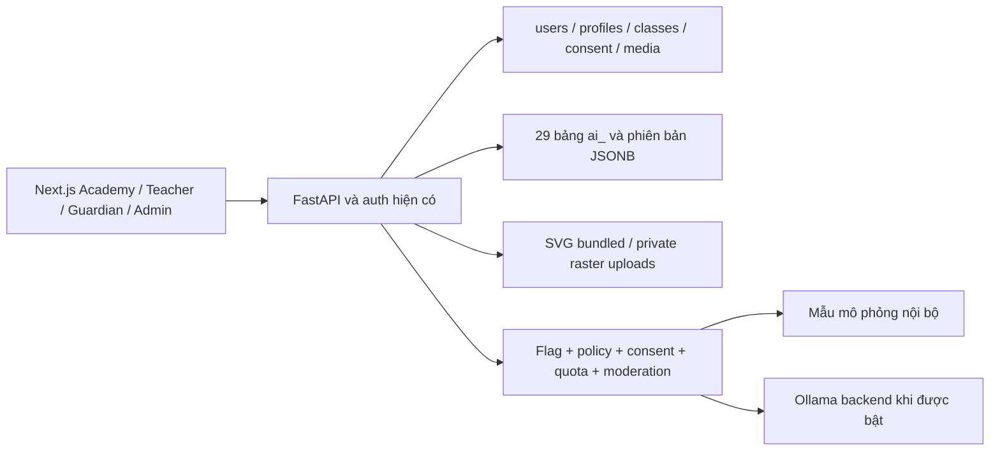

# Kiến trúc AI Academy

Next.js App Router gọi API cùng origin qua rewrite `/api/v1`; FastAPI dùng
SQLAlchemy Core/PostgreSQL hiện có. Không có app, auth, tài khoản hoặc DB thứ hai.
Session opaque HttpOnly, CSRF, bắt đổi mật khẩu tạm, rate limit và secure headers
tái sử dụng từ LMS. Bấm logo vẫn về dashboard của phiên đang đăng nhập.

## Các thành phần

`backend/app/academy`: curriculum*, media/manifest/assets, seed, schemas,
learning/grading, games, safety, providers/tutor, uploads, cms, api/management_api.
`frontend/src/features/academy`: player/activities/lab/tutor/creative,
staff/editor/admin/management/privacy, styles và các thành phần media.

Nội dung bước học, hoạt động, câu hỏi/lựa chọn ở JSONB của phiên bản bài;
Pydantic kiểm tra ID, số lượng, tuổi, lựa chọn, đáp án và độ dài. Quan hệ giao
bài, phiên bản, attempts, tiến độ, điểm và lớp dùng FK, unique và transaction.
Không tách bảng từng lựa chọn chỉ để lặp dữ liệu JSON.

## Bảo toàn tiến độ

Bắt đầu bài pin `version_id`; xuất bản phiên bản mới không đổi bài làm cũ.
Step tuần tự; hoạt động/checkpoint phải đạt 70% mới đi tiếp. Khôi phục điểm đã
đạt khi reload, không bắt chấm lại. Điểm thưởng một lần nhờ unique ledger;
attempt có idempotency key. Nháp nội dung và sản phẩm có revision, trả 409 khi
hai tab ghi đè. Teacher/editor không tự ghi điểm người học từ preview.
Ẩn bài rút bản published khỏi catalog và chặn học bài đó; không xóa bản/lịch sử.

## Phân quyền

| Chủ thể            | Quyền                                                             |
| ------------------ | ----------------------------------------------------------------- |
| Student            | Bài lớp hiện tại/lớp dưới, dữ liệu và sản phẩm của mình           |
| Teacher            | Lớp đang hoạt động do chính mình phụ trách, trẻ còn ghi danh      |
| Teacher + editor   | Tạo chủ đề/bài, lưu nháp, gửi duyệt, upload/generation            |
| Teacher + reviewer | Đọc CMS, duyệt/publish/ẩn, duyệt media                            |
| Guardian           | Đúng trẻ có `guardian_students.verified_at`, consent/dữ liệu      |
| Admin              | Quản trị toàn module; thao tác nhạy cảm xác nhận mật khẩu + audit |

Các quyền Academy mất hiệu lực nếu người dùng không còn global role teacher.
Catalog dùng chung một deployment; school scope qua profile/class/enrollment,
không tuyên bố cơ chế tenant riêng. Teacher được cấp editor không tự có quyền
quản lý lớp của giáo viên khác. Editor/reviewer tách bằng bảng riêng, không thay
enum role cũ.

## Hiệu năng và dịch vụ

Catalog lấy progress theo tập, ảnh lazy-load. Raster có original/responsive/
thumbnail; media nội bộ cache private 300 giây, API và upload no-store.
Cache session UI 30 giây và schema 60 giây đã có; quyền/consent đọc DB.
Không thêm Redis hoặc dịch vụ nặng. Job SVG nhỏ chạy chủ động, giữ trạng thái DB;
không giả vờ worker model chạy. Nếu thêm raster provider chậm, triển khai worker
có retry/idempotence trước khi bật flag.

AIProvider gồm simulation và Ollama. Ollama dùng `/api/chat`, không stream,
timeout 8 giây, tối đa 200 tokens, một retry lỗi kết nối/timeout; circuit breaker
3 lỗi nghỉ 60 giây mỗi worker. Đối chiếu [Ollama API chính thức](https://docs.ollama.com/api/chat).
Provider chỉ nhận ngữ liệu đã duyệt/chế độ/khối, không nguyên văn bài làm trẻ.
