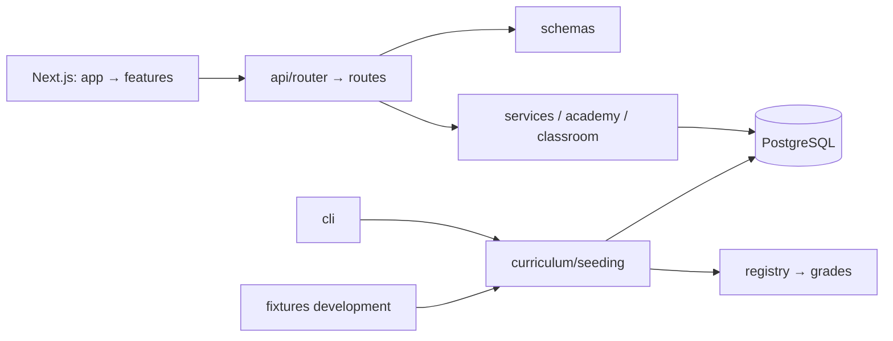

# Kiến trúc VietTree Education

FastAPI + Next.js App Router + PostgreSQL, tổ chức theo module trong một ứng dụng.
API, hợp đồng dữ liệu, nghiệp vụ, học liệu và tài khoản demo có trách nhiệm riêng.

```text
backend/app/
├── main.py, cli.py, db.py       # entry point, vận hành và kết nối/schema
├── api/router.py               # đăng ký router tại một nơi
├── api/routes/                 # auth, catalog, learning, assessments, attempts,
│                               # administration, accounts, memberships,
│                               # authoring, lesson_studio, curriculum, vip, operations
├── schemas/                    # hợp đồng request/response theo chức năng
├── services/                   # quy tắc/giao dịch nghiệp vụ LMS
├── curriculum/
│   ├── builders.py             # cấu trúc câu hỏi/bài học dùng chung
│   ├── registry.py             # chọn bộ, inventory và map theo khối
│   ├── seeding.py              # chỉ nạp học liệu, không tạo tài khoản
│   ├── lesson_content.py       # chuẩn hóa nội dung và phân bổ gợi ý khi đọc
│   ├── supplements/applied/    # pack tình huống riêng: builders, 3 môn, seed/inventory
│   ├── supplements/explorers/  # bài khám phá ngắn theo môn/khối
│   ├── supplements/release.py # cơ chế inventory/seed/verify dùng chung
│   ├── supplements/registry.py # đăng ký release cho CLI và quản trị
│   └── grades/
│       ├── early_primary/      # lớp 1–2: pack, math, vietnamese, english, builders
│       ├── grade_03/           # lớp 3: pack, math, vietnamese, english, builders
│       ├── grade_04/           # foundation, standard, advanced, vip, thinking, map
│       └── grade_05/           # pack, builders, math, vietnamese, readings, english
├── fixtures/                   # base_accounts, learners, development; chỉ development
├── core/                       # config, security, dependencies, seed_support
├── personalization/            # năng lực/kế hoạch từ kết quả thật
├── academy/                    # đào tạo AI, nội dung/media riêng
└── classroom/                  # lớp, giao bài, tuyên dương, giá VIP

frontend/src/
├── app/                        # URL/layout, ghép màn hình
├── features/
│   ├── student/                # dashboard, catalog, lesson, assessment, attempt,
│   │                           # result, history, progress, profile, learning-plan, lesson-library
│   ├── admin/                  # dashboard, students, questions, curriculum, system-status
│   ├── accounts/               # catalog, editor, form, security-action, security-page
│   ├── authoring/              # question-editor, assessment-editor, assignments, shared
│   ├── lessons/                # catalog, editor, content-fields, illustration-fields
│   ├── classrooms/             # catalog, roster, assignments, recognition, student
│   ├── curriculum/             # coverage, thinking, types, constants
│   ├── membership/             # pages, content-access, pricing
│   ├── vip/                    # workspace, sổ lỗi và báo cáo
│   ├── guardian/               # dashboard phụ huynh
│   └── academy/                # player, editor, lab, staff, quản trị AI
├── components/                 # thành phần dùng lại giữa các module
├── hooks/                      # hooks dùng chung
└── lib/                        # API client, session, types, CSV
```

Python dùng `snake_case`, package theo chức năng; không lặp tên khối trong mọi
file của cùng thư mục. React dùng file `kebab-case`, component `PascalCase`.
`types` chứa kiểu dữ liệu; `constants` chứa nhãn/cấu hình hiển thị. Import trực
tiếp module cần dùng, không thêm file tên cũ chỉ để chuyển tiếp. Không tạo một
`utils` hay một file chứa mọi trang mà không có trách nhiệm rõ ràng.

Lớp 1–2 dùng chung factory vì cùng cấu trúc bài ngắn nhưng khác ngữ liệu theo
`grade`. Lớp 4 giữ các đợt nội dung theo gói để bảo toàn mã/UUID/phiên bản đang
gắn với lịch sử. Registry giữ cả số kiểm kê riêng theo pack (lớp 5 có 9 chủ đề Toán).
Registry gom lựa chọn này để API và CLI không tự viết nhiều
nhánh. Học liệu/builders không import router, fixture, DB hoặc nghiệp vụ runtime;
runtime không tạo tài khoản mẫu. Có test bảo vệ ranh giới học liệu.



`main.py` và `app.cli` vẫn là entry point cũ: lệnh Uvicorn, Docker và Alembic
không đổi. Hai OpenAPI component ID nhận tên module mới; URL, request/response,
validation giữ nguyên. Nếu sinh client từ OpenAPI, sinh lại kiểu dữ liệu.
Source hashes xác nhận toàn bộ ngữ liệu không đổi sau refactor.

Đợt lớp 5 bổ sung pack `grade_05` và endpoint thư viện bài học, cùng năm kiểu
minh họa trong schema JSON. API mới chỉ trả metadata và tiến độ của học sinh
hiện tại; quyền nội dung vẫn kiểm tra tại backend. Xem [chi tiết lớp 5](grade5-curriculum.md).

SQL gốc `database/viettree_education_schema.sql` có 34 bảng, giữ nguyên; head
Alembic `0012_lesson_bookmarks` bổ sung auth/gói/nháp/AI/lớp/thành tích/lưu bài.
SQLAlchemy Core reflection bảng thật, không `create_all`; `/ready`,
`check-schema`, `check-system` kiểm tra schema/quyền/đề. Không reset/DROP/TRUNCATE.
UUID/codes và các FK ghép của attempt/answer giữ nguyên. Đề ghim đúng phiên bản
câu; seed không sửa published/đề cũ/tài khoản/lịch sử. Giao dịch ghi điểm,
mastery, sự kiện cùng transaction; free text không tự chấm. Quyền VIP/gợi ý lọc
tại API và kiểm tra live sau thu hồi. Phiên opaque HttpOnly lưu hash tại DB,
CSRF/Origin cho thao tác ghi; Next proxy `/api/v1` cùng origin.

Dependency database dùng chung ở `core/dependencies.py` với
`Depends(connection, scope="function")`: commit hoặc rollback trước khi gửi
phản hồi, theo [cơ chế scope của FastAPI](https://fastapi.tiangolo.com/tutorial/dependencies/dependencies-with-yield/#early-exit-and-scope).
Tránh phản hồi đăng nhập/duyệt/nộp thành công trong khi request kế tiếp chưa
thấy dữ liệu. Không dùng connection này cho việc nền sau khi trả phản hồi.
FastAPI tối thiểu 0.121; lock hiện dùng 0.143.0. Có kiểm thử ASGI đọc qua
connection PostgreSQL độc lập ngay trước khi gửi HTTP, cùng trường hợp rollback.

## Cách mở rộng

1. Khối mới đặt trong `curriculum/grades/grade_XX`, dùng builders chung, mã
   ổn định/ngữ liệu đúng tuổi. Đăng ký trong registry, khai báo nguồn/map và
   inventory riêng nếu quy mô khác. AI Academy có nội dung riêng; mẫu AI lớp
   5 không phải bộ ba môn LMS lớp 5.
2. `python -m app.cli curriculum-inventory --grade 1` kiểm kê source không cần
   DB; `seed-grade-content --grade 1` nạp đầy đủ một khối; `verify-seed --grade 1`
   kiểm kho DB. Source khác tổng kho có bài giáo viên tự tạo.
3. Schema cụ thể → service/giao dịch → route → đăng ký router. UI đặt trong
   feature tương ứng, route chỉ ghép trang. Chia các phần form có trách nhiệm
   riêng, không tách file chỉ để giảm số dòng.
4. Kiểm thử quyền, validation, đồng thời, giữ lịch sử trên DB test riêng; chạy
   luồng trình duyệt khi đổi UI. Production backup trước migration/nạp nội dung.

Admin **Chương trình → Theo dõi học liệu → Xuất học liệu CSV** tải đúng bộ lọc
khối/môn/mạch thiếu Free; có số bài Free/VIP, câu, đề và nguồn để rà soát. CSV
UTF-8 BOM, escape dấu nháy/xuống dòng và chặn công thức từ nội dung văn bản.

Xem [local](run-local.md), [VPS](deploy-vps.md), [demo theo khối](demo-accounts.md),
[kiểm chứng](IMPLEMENTATION_STATUS.md).

Học tiếp trên dashboard được chọn trong `services/resume_learning.py`: truy
vấn có giới hạn theo từng loại, lọc tài khoản/khối/trạng thái, dùng lại
authorization của lượt làm. Không cache entitlement hoặc tạo thêm bảng.
UI tại `features/student/resume-learning` dùng CSS module, đường dẫn theo loại
và metadata API; không tự suy quyền từ badge. Bộ `daily-2026-03` dùng builder
và publisher chung, đăng ký trong `curriculum/supplements/registry.py`.
