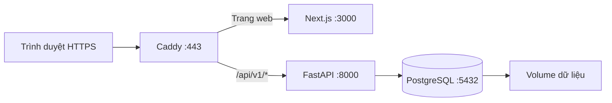

# Hướng dẫn deploy VietTree Education lên VPS

Cập nhật: **12/10/2026**. Hướng dẫn dành cho **Ubuntu Server 24.04 LTS**, một VPS,
một tên miền và dữ liệu hiện tại của dự án. Các khối `bash` chạy trên VPS; các
khối `powershell` chạy trên máy Windows đang chứa source code.

Phương án sử dụng Docker Compose, PostgreSQL 18, backend FastAPI, frontend Next.js
production và Caddy cấp/gia hạn HTTPS. Bộ cấu hình production đã có trong repo;
`docker-compose.yml` và Dockerfile trong backend/frontend vẫn phục vụ development.

Tài liệu đã được đối chiếu với code và tài liệu chính thức. Chưa chạy triển khai
trên VPS thực tế của bạn; cần thực hiện các bước kiểm tra ở mục 10 trước khi mở
cho học sinh sử dụng.

Head hiện tại **0011_classes_vip_training**. Sau migrate, cấp lại quyền runtime
bằng `deploy/grant-runtime.sql` để truy cập tám bảng mới. Giữ
`AI_TRAINING_ONLY=true`: phân hệ AI học lý thuyết/bài tập nội bộ, không gọi model.
Chạy `seed-ai-academy` nếu DB chưa có học liệu, `verify-ai-academy` để kiểm chứng.
Xem [triển khai Academy](ai-academy/deployment.md),
[lớp/thành tích](classes-achievements.md), [giá/ưu đãi](vip-pricing-research.md).
Giá là đề xuất tham khảo; release này chưa có thanh toán tự động.

Lớp 1–2 dùng schema hiện có, không migration mới. Sau backup/migrate/grant,
nạp nội dung một lần:

```bash
dc run --rm -T --no-deps backend python -m app.cli seed-grade1-content
dc run --rm -T --no-deps backend python -m app.cli seed-grade2-content
dc run --rm -T --no-deps backend python -m app.cli verify-seed --grade 1
dc run --rm -T --no-deps backend python -m app.cli verify-seed --grade 2
```

Xem [học liệu lớp 1–2](grades1-2-curriculum.md).
Hai lệnh không tạo demo, không đổi gói/mật khẩu/lịch sử, dùng được với production.

## 1. Chuẩn bị

| Thành phần            | Cấu hình sử dụng trong hướng dẫn                                                       |
| --------------------- | -------------------------------------------------------------------------------------- |
| Hệ điều hành          | Ubuntu Server 24.04 LTS, quyền root hoặc sudo                                          |
| Tài nguyên khởi đầu   | Đề xuất 2 vCPU, RAM 4 GB, SSD 40 GB trở lên; RAM 8 GB thuận tiện hơn khi build tại VPS |
| Tên miền ví dụ        | `hoc.example.com` — thay bằng tên miền thật                                            |
| Thư mục source        | `/opt/viettree-education`                                                              |
| Database              | `viettree-education`                                                                   |
| Tài khoản ứng dụng DB | `viettree_app`, không phải superuser                                                   |
| Cổng công khai        | SSH của VPS, TCP 80 và 443                                                             |
| Dữ liệu bền vững      | Docker volumes cho PostgreSQL và chứng chỉ Caddy                                       |

Đề xuất tài nguyên là mốc bắt đầu, chưa phải cam kết số người dùng đồng thời.
Hệ thống hiện rebuild thống kê sau nộp bài; cần đo tải trước khi phục vụ nhiều lớp.



API đi trực tiếp từ Caddy tới backend, cùng tên miền với giao diện. Điều này giữ
đúng cookie/CSRF và tránh việc mọi lượt đăng nhập mang IP của Next proxy.

## 2. DNS, SSH và firewall

Tạo bản ghi **A** cho tên miền trỏ tới IPv4 VPS. Chỉ tạo **AAAA** khi VPS có IPv6
hoạt động. Nếu dùng Cloudflare, bắt đầu với **DNS only**; cấu hình này giả định
trình duyệt kết nối trực tiếp đến VPS, chưa có CDN đứng trước Caddy.

Từ Windows:

```powershell
ssh root@VPS_IP
```

Thay `VPS_IP` bằng IP thật. Nếu nhà cung cấp cấp user `ubuntu` hoặc user khác,
SSH bằng user đó và chạy `sudo -i`. Các lệnh VPS tiếp theo chạy trong shell root.

```bash
apt-get update
apt-get install -y ca-certificates curl git openssl ufw dnsutils
timedatectl set-timezone Asia/Bangkok
ufw allow 22/tcp
ufw allow 80/tcp
ufw allow 443/tcp
ufw enable
ufw status
dig +short hoc.example.com A
```

Nếu SSH dùng cổng khác 22, mở đúng cổng đó trước khi bật UFW. Mở các cổng tương
ứng trong firewall/security group của nhà cung cấp. Không publish cổng 3000,
8000 hoặc 5432 trong cấu hình bên dưới. Docker có thể bỏ qua quy tắc UFW đối với
cổng container được publish; vì vậy không dựa riêng vào UFW để bảo vệ DB.
[Tài liệu Docker về firewall](https://docs.docker.com/engine/network/packet-filtering-firewalls/).

## 3. Cài Docker Engine và Compose

Trên Ubuntu mới, chưa có bộ Docker khác:

```bash
install -m 0755 -d /etc/apt/keyrings
curl -fsSL https://download.docker.com/linux/ubuntu/gpg -o /etc/apt/keyrings/docker.asc
chmod a+r /etc/apt/keyrings/docker.asc
cat > /etc/apt/sources.list.d/docker.sources <<EOF
Types: deb
URIs: https://download.docker.com/linux/ubuntu
Suites: $(. /etc/os-release && echo "${UBUNTU_CODENAME:-$VERSION_CODENAME}")
Components: stable
Architectures: $(dpkg --print-architecture)
Signed-By: /etc/apt/keyrings/docker.asc
EOF
apt-get update
apt-get install -y docker-ce docker-ce-cli containerd.io docker-buildx-plugin docker-compose-plugin
systemctl enable --now docker
docker version
docker compose version
```

Nếu VPS đã cài Docker, đối chiếu hướng dẫn chính thức trước khi thay package.
[Cài Docker trên Ubuntu](https://docs.docker.com/engine/install/ubuntu/).
Không cần cài Node.js, Python hay PostgreSQL trực tiếp trên VPS cho phương án này.

## 4. Đưa đúng source code lên VPS

**Chọn một cách.** Nếu code local còn thay đổi chưa commit/push, dùng cách A để
tránh deploy thiếu chức năng vừa viết. Không đưa `.env` local, virtualenv hoặc
`node_modules` lên server.

### Cách A — đóng gói source đang có trên Windows

Trên Windows, tại một terminal mới:

```powershell
tar -czf "$env:TEMP/viettree-source.tar.gz" --exclude=.git --exclude=.venv --exclude=node_modules --exclude=.next --exclude=.env --exclude='.env.*' --exclude=.tools --exclude=test-results --exclude=playwright-report --exclude=__pycache__ --exclude=.pytest_cache --exclude=.ruff_cache -C 'D:\01_viettree_code\viettree-education' .
scp "$env:TEMP/viettree-source.tar.gz" root@VPS_IP:/root/
```

Trên VPS, dùng thư mục chưa chứa một bản triển khai khác:

```bash
mkdir -p /opt/viettree-education
tar -xzf /root/viettree-source.tar.gz -C /opt/viettree-education
cd /opt/viettree-education
```

### Cách B — lấy release đã commit/push

Thay `REPO_URL` và `RELEASE_TAG` bằng repository và tag/commit đã kiểm thử:

```bash
git clone REPO_URL /opt/viettree-education
cd /opt/viettree-education
git checkout RELEASE_TAG
```

Từ đây, chạy lệnh tại `/opt/viettree-education`, trừ khi có chỉ dẫn khác.

Trong `.dockerignore`, giữ các mục đang có và bổ sung hai dòng sau để cả env nằm
trong thư mục con cũng không được đưa vào image:

```text
**/.env
**/.env.*
```

## 5. Tạo cấu hình production

### 5.1. Biến môi trường

```bash
umask 077
cp .env.production.example .env.production
chmod 600 .env.production
openssl rand -hex 32
openssl rand -hex 32
openssl rand -hex 32
```

Điền tên miền/email thật và ba mật khẩu độc lập vào `.env.production` bằng editor:
`POSTGRES_ADMIN_PASSWORD` cho quản trị PostgreSQL, `DB_OWNER_PASSWORD` cho role
migration `viettree_owner`, `DB_PASSWORD` cho ứng dụng `viettree_app`. Thay toàn bộ
giá trị `CHANGE_ME`; giữ `DB_USER=viettree_app`. Không dùng mật khẩu demo.
Giá trị hex thuận tiện khi Compose đọc env; không chạy `source .env.production`.
File env thật đã được ignore và loại khỏi Docker build context.

Đặt `RELEASE` theo release để giữ image cũ cho phục hồi; thời hạn phiên mặc định
8 giờ, ghi nhớ học sinh 7 ngày. Compose đặt `APP_ENV=production`, HTTPS origins
và cookie Secure. Backend từ chối origin rỗng, wildcard, URL có đường dẫn và
tên môi trường không hợp lệ.

### 5.2. Các file cấu hình có sẵn

Không cần chép lại Dockerfile hay YAML từ tài liệu:

- [docker-compose.production.yml](../docker-compose.production.yml): PostgreSQL,
  backend, frontend, Caddy; chỉ publish 80/443, healthcheck, giới hạn log.
- [backend.production.Dockerfile](../deploy/backend.production.Dockerfile): dùng
  dependency lock, hai worker Uvicorn, user không phải root, không hot reload.
- [frontend.production.Dockerfile](../deploy/frontend.production.Dockerfile):
  build Next.js standalone, chạy user không phải root.
- [Caddyfile](../deploy/Caddyfile): HTTPS, API trực tiếp đến backend, ghi đè
  X-Forwarded-For bằng IP kết nối, chặn docs/readiness bên ngoài, body tối đa 1 MB.
- [grant-runtime.sql](../deploy/grant-runtime.sql): cấp quyền dữ liệu cho ứng dụng;
  role migration sở hữu cấu trúc, ứng dụng không có quyền CREATE trên public.
- [backup.sh](../deploy/backup.sh): backup custom archive, quyền file riêng,
  kiểm tra archive trước khi đổi thành tên bản sao lưu hoàn chỉnh.

Caddy có IP cố định `172.30.40.2` trên mạng `172.30.40.0/24`; Uvicorn chỉ tin
forwarded headers từ IP này. Nếu subnet trùng mạng VPS, sửa đồng thời subnet,
IP Caddy và `--forwarded-allow-ips` trong Dockerfile rồi build lại.
Không dùng `*` cho proxy trust. Cấu hình này giả định không có CDN đứng trước VPS.

Backend giới hạn mặc định 120 lượt đăng nhập/IP/phút và 10 lượt/tên đăng nhập/phút,
đếm chung trong PostgreSQL giữa worker. Nhiều học sinh dùng chung mạng có thể
đăng nhập; thử sai liên tục cùng tài khoản nhận 429 với Retry-After 60 giây.
Các mốc này là cấu hình ban đầu; đo tải thực tế trước khi tăng.
Body limit theo [Caddy request_body](https://caddyserver.com/docs/caddyfile/directives/request_body);
thứ tự khởi động theo [Compose healthchecks](https://docs.docker.com/compose/how-tos/startup-order/).

### 5.6. Kiểm tra và build

Định nghĩa lệnh rút gọn trong shell hiện tại:

```bash
dc() {
  docker compose --project-name viettree --env-file .env.production -f docker-compose.production.yml "$@"
}
dc config --quiet
dc build backend frontend
dc run --rm --no-deps caddy caddy validate --config /etc/caddy/Caddyfile --adapter caddyfile
```

Mở terminal mới thì `cd /opt/viettree-education` và định nghĩa lại `dc`.
`config --quiet` kiểm tra cấu hình mà không in mật khẩu đã được interpolate.
Lần build đầu cần Internet để tải image và dependency. Nếu build bị hết RAM,
build từng service hoặc dùng VPS/build runner có nhiều RAM hơn.

Ghi lại nhãn image/tag hoặc digest đã triển khai để dùng cùng phiên bản khi
khôi phục. Các tag major trong ví dụ nhận bản vá mới khi pull/build lại.

## 6. Khởi tạo PostgreSQL và tách role migration/ứng dụng

Chưa khởi động ứng dụng ở bước này:

```bash
dc up -d db
dc ps
dc exec db psql -U postgres -d postgres
```

Trong psql, chạy một lần trên VPS mới:

```sql
CREATE ROLE viettree_owner LOGIN NOSUPERUSER NOCREATEDB NOCREATEROLE;
\password viettree_owner
CREATE ROLE viettree_app LOGIN NOSUPERUSER NOCREATEDB NOCREATEROLE;
\password viettree_app
ALTER DATABASE "viettree-education" OWNER TO viettree_owner;
\connect "viettree-education"
REVOKE CREATE ON SCHEMA public FROM PUBLIC;
GRANT USAGE, CREATE ON SCHEMA public TO viettree_owner;
\q
```

Nhập đúng `DB_OWNER_PASSWORD` và `DB_PASSWORD` ở các lời nhắc tương ứng.
Superuser password chỉ dành cho quản trị PostgreSQL. Nếu role đã có, kiểm tra
`\du`; không tạo lại, không tự thay quyền/owner của DB đang được sử dụng.
Đổi env không tự đổi mật khẩu nằm trong volume; dùng `\password` rồi recreate.
Nếu VPS cũ dùng `viettree_app` làm owner, cần kế hoạch chuyển ownership riêng
hoặc restore sang DB mới; chạy grant script không xóa quyền sở hữu cũ.

## 7. Nạp dữ liệu — chọn một trong hai nhánh

**Nhánh A phù hợp với hệ thống đang có của bạn.** Không chạy nhánh B sau khi
restore dump đầy đủ. Không import SQL gốc đè lên database đã có dữ liệu.

### A. Chuyển toàn bộ dữ liệu hiện tại từ máy Windows

Tạm dừng các thao tác ghi vào DB nguồn trong cửa sổ chuyển đổi. Sau khi chuyển,
chỉ sử dụng bản trên VPS để tránh hai bộ lịch sử khác nhau. Dùng `pg_dump` cùng
major với PostgreSQL nguồn; ví dụ DB local hiện tại là PostgreSQL 18.

Trên Windows, với PostgreSQL tools đã có trong PATH:

```powershell
pg_dump --version
pg_dump -h localhost -p 5432 -U postgres -W -d "viettree-education" -Fc --file="$env:TEMP/viettree-local.dump"
if ($LASTEXITCODE -ne 0) { throw 'Backup database thất bại' }
scp "$env:TEMP/viettree-local.dump" root@VPS_IP:/root/
```

`-W` hỏi mật khẩu DB local. Dùng `--file` để ghi dump nhị phân; không dùng
PowerShell redirect `>` cho file này. Dump chứa schema, nội dung, tài khoản,
gói, tiến độ và lịch sử; không cần copy `.env` local. PostgreSQL đích không nên
cũ hơn major nguồn.
[Hướng dẫn PostgreSQL dump/restore](https://www.postgresql.org/docs/18/backup-dump.html).

Trên VPS, **chỉ restore vào database mới và trống**:

```bash
chmod 600 /root/viettree-local.dump
dc exec -T db pg_restore --exit-on-error --single-transaction --no-owner --no-privileges -U viettree_owner -d viettree-education < /root/viettree-local.dump
dc run --rm --no-deps migrate
dc exec -T db psql -X -v ON_ERROR_STOP=1 -U viettree_owner -d viettree-education < deploy/grant-runtime.sql
dc run --rm --no-deps backend python -m app.cli check-schema
```

`--no-owner --no-privileges` dùng quyền của role đích, không mang role `postgres`
local hoặc ACL cũ sang ứng dụng. Nếu restore báo lỗi, dừng và xử lý; không chạy
`--clean`, DROP hoặc TRUNCATE để sửa database đang được sử dụng.
[Tài liệu pg_restore](https://www.postgresql.org/docs/18/app-pgrestore.html).

Trước khi công khai, thu hồi phiên cũ và vô hiệu hóa các tài khoản demo đã biết:

```bash
dc exec -T db psql -X -v ON_ERROR_STOP=1 -U viettree_app -d viettree-education <<'SQL'
BEGIN;
UPDATE auth_sessions SET revoked_at = NOW() WHERE revoked_at IS NULL;
UPDATE users SET is_active = FALSE
WHERE LOWER(username) IN ('longnh', 'free4_01', 'free4_02', 'vip4_01', 'vip4_02');
COMMIT;
SQL
```

Lệnh giữ tài khoản/lịch sử nhưng không cho các account demo đăng nhập. Chỉ chạy
danh sách này khi chúng vẫn là các tài khoản demo của dự án; nếu đã đổi mục đích
sử dụng, chọn đúng account cần khóa. Đổi mật khẩu admin ở mục 8, không dùng mật
khẩu từ `.env.example` trên Internet.

### B. Tạo hệ thống mới từ database trống

Nếu chưa có dữ liệu cần chuyển:

```bash
dc exec -T db psql -X -v ON_ERROR_STOP=1 -U viettree_owner -d viettree-education < database/viettree_education_schema.sql
dc run --rm --no-deps migrate
dc exec -T db psql -X -v ON_ERROR_STOP=1 -U viettree_owner -d viettree-education < deploy/grant-runtime.sql
dc run --rm --no-deps backend python -m app.cli check-schema
```

`app.cli seed` bị chặn ở production vì tạo tài khoản demo. Muốn nạp bộ nội dung
lớp 3 và 4 mà không tạo demo, chạy riêng các hàm nội dung trong một transaction:

```bash
dc run --rm -T --no-deps backend python - <<'PY'
from sqlalchemy import text
from app.db import db, engine
from app.expanded_curriculum import EXPANDED
from app.vip_curriculum import VIP_EXTENSION
from app.seed import seed_content, seed_access_policies, seed_advanced_content, seed_grade4_content, seed_grade3_content, verify_seed

with engine().begin() as conn:
    db.load(conn)
    conn.execute(text("SELECT pg_advisory_xact_lock(78249100)"))
    seed_content(conn)
    seed_access_policies(conn)
    seed_advanced_content(conn)
    seed_advanced_content(conn, EXPANDED)
    seed_advanced_content(conn, VIP_EXTENSION)
    seed_grade4_content(conn)
    seed_grade3_content(conn)
    print(verify_seed(conn))
    print(verify_seed(conn, grade=3))
PY
```

Giữ `APP_ENV=production`; không đổi sang development để vượt chặn seed.
Kết quả trên DB mới: mỗi lớp 68 bài/384 câu/56 đề, 21 chủ đề/kỹ năng của 3 môn;
hai lớp tổng 136 bài/768 câu/112 đề. Lớp 3 có gợi ý Free/VIP theo bước;
xem [học liệu lớp 3](grade3-curriculum.md).
Bộ nội dung cần được giáo viên rà soát trước dùng thật; xem [đối chiếu lớp 4](grade4-curriculum.md).
Nếu muốn chương trình trống để tự biên soạn, bỏ qua khối nạp nội dung này.

VPS đã có bộ nền tảng: sau khi backup và rà soát bộ bổ sung, nạp riêng bằng
`dc run --rm -T --no-deps backend python -m app.cli seed-grade4-content`.
Để thêm lớp 3: `dc run --rm -T --no-deps backend python -m app.cli seed-grade3-content`.
Lệnh này không cấp gói hay tạo tài khoản. Không cần migration mới ngoài head hiện tại.

## 8. Quản trị đầu tiên và tài khoản thật

Database mới chưa có admin: dùng terminal SSH tương tác, không thêm `-T`:

```bash
dc run --rm --no-deps backend python -m app.cli bootstrap-admin --username admin --display-name "Quản trị VietTree"
```

Nhập mật khẩu ít nhất 15 ký tự hai lần; mật khẩu không nằm trong lệnh, log hay
file cấu hình. Công cụ chỉ tạo quản trị đầu tiên khi chưa có admin hoạt động,
không đổi mật khẩu/vai trò của username có sẵn. Có audit cho thao tác tạo.

Nếu đã restore DB có admin, đăng nhập bằng tài khoản đó rồi vào **Bảo mật tài
khoản** để đổi mật khẩu trước khi mở truy cập cho học sinh. Luồng này thu hồi
toàn bộ phiên cũ. Khi kiểm tra mật khẩu cũ qua web, giới hạn truy cập Caddy bằng
firewall nhà cung cấp cho IP người vận hành; mở rộng sau khi hoàn tất mục 10.
Không chạy bootstrap để ghi đè admin cũ. Nếu mất mật khẩu admin, cần quy trình
khôi phục có xác minh người vận hành; công cụ này không tự reset.

Tạo học sinh thật qua **Quản trị tài khoản**, chọn lớp 3/4, mật khẩu tạm và yêu
cầu đổi trước khi học. Mặc định Free; cấp/gia hạn/thu hồi VIP qua quản trị.
Không dùng `seed-demo-learners` trên production.

## 9. Khởi động và HTTPS

```bash
dc up -d backend frontend caddy
dc ps
dc logs --tail=100 backend frontend caddy
```

Đợi backend/frontend healthy và Caddy cấp chứng chỉ. Truy cập tên miền đã điền
trong env, ví dụ **https://hoc.example.com**; đăng nhập admin bằng mật khẩu mới.
Không cần `npm run dev`, Uvicorn `--reload` hoặc Certbot trong phương án này.

Docker tự khởi động theo systemd; `restart: unless-stopped` giúp các service đang
chạy được khởi động lại sau reboot. Service bị chủ động `stop` cần `dc up -d`.

## 10. Kiểm tra sau deploy

```bash
curl -I http://hoc.example.com
curl -I https://hoc.example.com/login
curl -fsS https://hoc.example.com/health
dc exec backend python -c "import urllib.request; print(urllib.request.urlopen('http://127.0.0.1:8000/ready').read().decode())"
dc run --rm --no-deps backend python -m alembic current
dc run --rm --no-deps backend python -m app.cli check-schema
dc run --rm --no-deps backend python -m app.cli check-system
dc exec -T db psql -X -U viettree_app -d viettree-education < database/seeds/verify.sql
```

Thay tên miền trong các lệnh. HTTP chuyển sang HTTPS; login và health trả 200;
readiness nội bộ báo DB/schema sẵn sàng. Head hiện tại là
`0011_classes_vip_training`; khi có release mới, dùng head của release đó.
Revision 0008 thêm ba cột quản trị tài khoản; 0009 bổ sung quyền gợi ý VIP.
Các migration giữ mật khẩu/phiên/gói/lịch sử cũ;
không seed/reset tài khoản khi nâng cấp. Mở **Quản trị tài khoản** để cấp tài
khoản thật, dùng mật khẩu tạm và yêu cầu đổi trước khi học. Chi tiết và giới hạn:
[account-management.md](account-management.md).

Trên browser, kiểm tra thêm:

- Admin đăng nhập/đăng xuất, mở **Kiểm tra hệ thống** (`/admin/system`): các
  kiểm tra migration/quyền nội dung/đề đều đạt; xem chương trình và bài tập.
- Tài khoản học sinh thật mở được bài Free; bài VIP hiện giới thiệu khi chưa nâng cấp.
- Admin cấp VIP cho account thử riêng rồi kiểm tra bài nâng cao và thu hồi.
- Tạo một bài thử riêng, giao đúng học sinh; học sinh lưu, tải lại, nộp, xem kết quả.
- Cookie `viettree_session` có Secure/HttpOnly; các thao tác ghi không báo CSRF 403.
- `/docs`, `/openapi.json`, `/ready` không công khai. Cổng DB/backend/frontend
  không được truy cập trực tiếp từ một máy ngoài VPS.

Chọn tài khoản và nội dung thử riêng; thao tác nộp bài trên VPS ghi lịch sử thật.
Không chạy pytest/browser E2E của repo vào database production.

## 11. Sao lưu tự động và phục hồi thử

### 11.1. Backup mỗi ngày

Script đã có trong repo; chạy thử trước khi đặt lịch:

```bash
apt-get install -y cron
bash deploy/backup.sh
ls -lh /var/backups/viettree
cat > /etc/cron.d/viettree-backup <<'CRON'
SHELL=/bin/bash
PATH=/usr/local/sbin:/usr/local/bin:/usr/sbin:/usr/bin:/sbin:/bin
15 2 * * * root bash /opt/viettree-education/deploy/backup.sh >> /var/log/viettree-backup.log 2>&1
CRON
chmod 644 /etc/cron.d/viettree-backup
systemctl enable --now cron
```

Lịch 02:15 Asia/Bangkok; tên dump dùng UTC. Script dùng DB_NAME của container,
không nạp env bằng source; file 600, thư mục 700. Chỉ công bố file sau khi
`pg_dump` và `pg_restore --list` thành công; không tự xóa backup cũ.
Đặt `VIETTREE_BACKUP_DIR` nếu cần thư mục khác, theo dõi log/dung lượng và đặt
retention phù hợp. Backup cùng VPS cần được sao chép sang kho riêng có mã hóa,
quyền truy cập hạn chế; giữ bản env an toàn và release đã triển khai.
Không chép trực tiếp thư mục dữ liệu PostgreSQL đang chạy để làm backup.

### 11.2. Thử restore vào database riêng

Chọn một backup thật, tạo DB **mới** `viettree-restore-check` trên VPS:

```bash
dc exec -T db createdb -U postgres -O viettree_owner viettree-restore-check
dc exec -T db pg_restore --exit-on-error --single-transaction --no-owner --no-privileges -U viettree_owner -d viettree-restore-check < /var/backups/viettree/TEN_FILE_BACKUP.dump
dc exec -T db psql -X -v ON_ERROR_STOP=1 -U viettree_owner -d viettree-restore-check < deploy/grant-runtime.sql
dc run --rm --no-deps -e DB_NAME=viettree-restore-check backend python -m app.cli check-schema
dc exec -T db psql -X -U viettree_app -d viettree-restore-check -c 'SELECT COUNT(*) FROM users; SELECT COUNT(*) FROM attempts;'
```

Không trỏ dịch vụ production sang DB thử. `pg_restore --list` chỉ kiểm tra archive;
restore thử mới kiểm tra được quá trình phục hồi. Nếu tên DB thử đã có, chọn một
tên mới để giữ kết quả thử cũ. Khi cần phục hồi production, dựng DB mới từ backup,
kiểm tra, dừng ghi ứng dụng rồi chuyển `DB_NAME` và recreate backend; không restore
đè khi học sinh đang làm bài. Dữ liệu sau thời điểm backup cần được đối soát riêng.

## 12. Cập nhật release và rollback

Trước cập nhật, ghi lại commit/tag hoặc bản source hiện tại và image đang chạy:

```bash
dc images
bash /opt/viettree-education/deploy/backup.sh
```

Chọn cửa sổ bảo trì ít người dùng. Nếu deployment từ Git, kiểm tra worktree và
lấy đúng release; không dùng `git reset --hard` để bỏ thay đổi đang có. Nếu deploy
bằng archive, giữ bản source cũ và giải nén release mới vào thư mục staging để
đối chiếu trước khi thay source; giữ `.env.production` và bộ cấu hình của VPS.

Có thể gắn nhãn image ứng dụng để giữ release cũ:

```bash
export RELEASE=2026-10-10-v1
dc build backend frontend
dc stop caddy frontend backend
dc run --rm --no-deps migrate
dc exec -T db psql -X -v ON_ERROR_STOP=1 -U viettree_owner -d viettree-education < deploy/grant-runtime.sql
dc run --rm --no-deps backend python -m app.cli check-schema
dc up -d backend frontend caddy
```

Thay nhãn mỗi release. Build trước khi dừng ứng dụng để giảm thời gian bảo trì.
Nếu migration lỗi, giữ ứng dụng dừng và xử lý, không tiếp tục bước khởi động.
Sau cập nhật, chạy lại kiểm tra mục 10. Không chạy lại seed demo khi cập nhật.
Muốn bổ sung bộ nội dung mới, review script nội dung và chạy chủ động với backup.

Mở shell mới cần đặt lại nhãn `RELEASE` đang sử dụng, hoặc ghi nhãn vào
`.env.production`; nếu không, Compose sẽ mặc định tag `local`.

Rollback **code** chỉ khi image cũ chấp nhận revision DB hiện tại và schema
vẫn tương thích. Readiness của release mới yêu cầu đúng migration head; không
downgrade chỉ để làm healthcheck xanh. Thử trên staging trước:

```bash
export RELEASE=NHAN_RELEASE_CU
dc up -d --no-build --pull never backend frontend caddy
```

Giữ image cũ trên máy, kiểm tra lại readiness và luồng login/học. Nếu schema không
tương thích, cần kế hoạch phục hồi DB mới từ backup; rollback image đơn thuần không
đủ. Không tự `alembic downgrade`: một số downgrade của dự án xóa các bảng gói/auth.

Không dùng `docker compose down -v`, `docker volume prune` hoặc xóa volume DB trong
quy trình cập nhật. Không đổi project name `viettree`, nếu không Compose có thể
tạo volume khác và trông giống như dữ liệu bị mất.

## 13. Lệnh vận hành và xử lý lỗi

```bash
dc ps
dc logs --tail=100 backend
dc logs --tail=100 frontend
dc logs --tail=100 caddy
dc logs --tail=100 db
docker stats --no-stream
df -h
```

| Hiện tượng                        | Kiểm tra / xử lý                                                                                                |
| --------------------------------- | --------------------------------------------------------------------------------------------------------------- |
| Domain không vào hoặc HTTPS lỗi   | A/AAAA, firewall nhà cung cấp, cổng 80/443 đang bị Nginx/Apache khác chiếm; xem log Caddy                       |
| Caddy báo 502                     | Backend/frontend health, log khởi động, build đúng file production                                              |
| Backend khởi động thất bại        | APP_ENV/HTTPS origins/cookie secure, role DB riêng, password tối thiểu 16 ký tự                                 |
| DB password authentication failed | `DB_PASSWORD` có khớp mật khẩu đã đặt bằng `\password`; sửa env rồi `dc up -d --force-recreate backend`         |
| Readiness 503, thiếu bảng/cột     | Chạy migration và check-schema; xem nhánh import/restore đã chọn đúng chưa                                      |
| Login 403 hoặc lưu bài CSRF 403   | Domain khớp ALLOWED_ORIGINS, dùng HTTPS; xóa cookie cũ/đăng nhập lại, kiểm tra Origin                           |
| Nhiều học sinh gặp 429 login      | API phải đi Caddy → backend, IP Caddy trùng forwarded-allow-ips; nếu dùng CDN, hoàn thiện trusted proxies trước |
| DB trông như trống sau recreate   | Kiểm tra project name và `docker volume ls`; không tạo seed mới hoặc xóa volume trước khi tìm volume cũ         |
| Sửa frontend không có hiệu lực    | Build lại image và recreate; production không mount source để hot reload                                        |
| Build bị killed / VPS hết RAM     | Build lần lượt, tăng RAM hoặc build trên máy khác rồi đẩy image                                                 |
| Backup không chạy                 | Xem cron/service và `/var/log/viettree-backup.log`; chạy script bằng tay, kiểm tra dung lượng và `db` healthy   |

Volumes giữ dữ liệu qua recreate; healthcheck báo lỗi nhưng Docker không tự
restart chỉ vì trạng thái unhealthy. Cần theo dõi health, log, dung lượng và cảnh
báo ngoài VPS; `restart` xử lý trường hợp tiến trình/container thoát.

Sau khi hệ thống chạy ổn, cố định image bằng tag/digest đã kiểm thử, cập nhật bản
vá trong cửa sổ bảo trì và thử restore định kỳ. VPS đơn là điểm lỗi chung của cả
web và DB; backup ngoài VPS là phần bắt buộc để phục hồi khi mất máy.

## 14. Bảo trì auth và kiểm tra định kỳ

```bash
dc run --rm --no-deps backend python -m app.cli check-system
dc run --rm --no-deps backend python -m app.cli cleanup-auth --retention-days 30
```

Lệnh đầu chỉ đọc và exit 1 nếu có kiểm tra không đạt. Lệnh thứ hai mặc định
dry-run: chỉ đếm phiên đã hết hạn/thu hồi và cửa sổ login cũ hơn 30 ngày.
Sau khi đối chiếu chính sách lưu trữ, thực hiện bằng thêm `--apply`; không chạm
phiên sống, account, gói học, audit hay lịch sử học tập. Có thể đặt cron hàng
ngày sau backup cho lệnh apply này. Quyền auth vẫn kiểm tra DB mỗi request.

Đối chiếu [bản kiểm tra trước triển khai](production-readiness.md) để biết các
kiểm chứng local đã chạy và những kiểm tra cần hoàn thành trên server thật.

# Bổ sung AI Academy · 12/10/2026

Head hiện tại `0011_classes_vip_training` bao gồm `0010_ai_academy`; sau migration/grant chạy
`python -m app.cli seed-ai-academy`, rồi `verify-ai-academy`.
Production Compose có volume riêng `academy_media`; script backup tạo cặp
database dump và `media.tar.gz`, cần giữ/phục hồi cả hai. Các hướng dẫn cũ về
head 0009 là mốc trước module; luôn dùng `alembic upgrade head` cho bản hiện tại.
Xem [triển khai AI Academy](ai-academy/deployment.md) cho local, Docker, model
mặc định tắt, quyền teacher/guardian, backup và xử lý lỗi.
