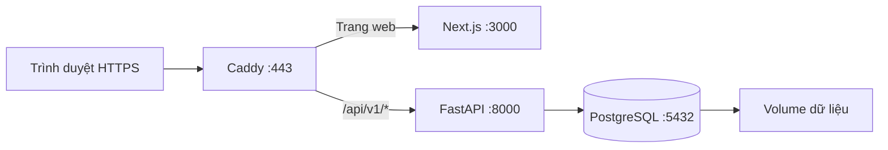

# Hướng dẫn deploy VietTree Education lên VPS

Cập nhật: **10/10/2026**. Hướng dẫn dành cho **Ubuntu Server 24.04 LTS**, một VPS,
một tên miền và dữ liệu hiện tại của dự án. Các khối `bash` chạy trên VPS; các
khối `powershell` chạy trên máy Windows đang chứa source code.

Phương án sử dụng Docker Compose, PostgreSQL 18, backend FastAPI, frontend Next.js
production và Caddy cấp/gia hạn HTTPS. Compose và Dockerfile hiện có trong repo
phục vụ development; hướng dẫn này tạo bộ cấu hình riêng, không sửa chúng.

Tài liệu đã được đối chiếu với code và tài liệu chính thức. Chưa chạy triển khai
trên VPS thực tế của bạn; cần thực hiện các bước kiểm tra ở mục 10 trước khi mở
cho học sinh sử dụng.

## 1. Chuẩn bị

| Thành phần            | Cấu hình sử dụng trong hướng dẫn                                                       |
| --------------------- | -------------------------------------------------------------------------------------- |
| Hệ điều hành          | Ubuntu Server 24.04 LTS, quyền root hoặc sudo                                          |
| Tài nguyên khởi đầu   | Đề xuất 2 vCPU, RAM 4 GB, SSD 40 GB trở lên; RAM 8 GB thuận tiện hơn khi build tại VPS |
| Tên miền ví dụ        | `hoc.example.com` — thay bằng tên miền thật                                            |
| Thư mục source        | `/opt/viettree-education`                                                              |
| Database              | `viettree-education`                                                                   |
| Tài khoản ứng dụng DB | `viettree_app`, không phải superuser                                                   |
| Cổng công khai        | SSH của VPS, TCP 80 và 443                                                             |
| Dữ liệu bền vững      | Docker volumes cho PostgreSQL và chứng chỉ Caddy                                       |

Đề xuất tài nguyên là mốc bắt đầu, chưa phải cam kết số người dùng đồng thời.
Hệ thống hiện rebuild thống kê sau nộp bài; cần đo tải trước khi phục vụ nhiều lớp.



API đi trực tiếp từ Caddy tới backend, cùng tên miền với giao diện. Điều này giữ
đúng cookie/CSRF và tránh việc mọi lượt đăng nhập mang IP của Next proxy.

## 2. DNS, SSH và firewall

Tạo bản ghi **A** cho tên miền trỏ tới IPv4 VPS. Chỉ tạo **AAAA** khi VPS có IPv6
hoạt động. Nếu dùng Cloudflare, bắt đầu với **DNS only**; cấu hình này giả định
trình duyệt kết nối trực tiếp đến VPS, chưa có CDN đứng trước Caddy.

Từ Windows:

```powershell
ssh root@VPS_IP
```

Thay `VPS_IP` bằng IP thật. Nếu nhà cung cấp cấp user `ubuntu` hoặc user khác,
SSH bằng user đó và chạy `sudo -i`. Các lệnh VPS tiếp theo chạy trong shell root.

```bash
apt-get update
apt-get install -y ca-certificates curl git openssl ufw dnsutils
timedatectl set-timezone Asia/Bangkok
ufw allow 22/tcp
ufw allow 80/tcp
ufw allow 443/tcp
ufw enable
ufw status
dig +short hoc.example.com A
```

Nếu SSH dùng cổng khác 22, mở đúng cổng đó trước khi bật UFW. Mở các cổng tương
ứng trong firewall/security group của nhà cung cấp. Không publish cổng 3000,
8000 hoặc 5432 trong cấu hình bên dưới. Docker có thể bỏ qua quy tắc UFW đối với
cổng container được publish; vì vậy không dựa riêng vào UFW để bảo vệ DB.
[Tài liệu Docker về firewall](https://docs.docker.com/engine/network/packet-filtering-firewalls/).

## 3. Cài Docker Engine và Compose

Trên Ubuntu mới, chưa có bộ Docker khác:

```bash
install -m 0755 -d /etc/apt/keyrings
curl -fsSL https://download.docker.com/linux/ubuntu/gpg -o /etc/apt/keyrings/docker.asc
chmod a+r /etc/apt/keyrings/docker.asc
cat > /etc/apt/sources.list.d/docker.sources <<EOF
Types: deb
URIs: https://download.docker.com/linux/ubuntu
Suites: $(. /etc/os-release && echo "${UBUNTU_CODENAME:-$VERSION_CODENAME}")
Components: stable
Architectures: $(dpkg --print-architecture)
Signed-By: /etc/apt/keyrings/docker.asc
EOF
apt-get update
apt-get install -y docker-ce docker-ce-cli containerd.io docker-buildx-plugin docker-compose-plugin
systemctl enable --now docker
docker version
docker compose version
```

Nếu VPS đã cài Docker, đối chiếu hướng dẫn chính thức trước khi thay package.
[Cài Docker trên Ubuntu](https://docs.docker.com/engine/install/ubuntu/).
Không cần cài Node.js, Python hay PostgreSQL trực tiếp trên VPS cho phương án này.

## 4. Đưa đúng source code lên VPS

**Chọn một cách.** Nếu code local còn thay đổi chưa commit/push, dùng cách A để
tránh deploy thiếu chức năng vừa viết. Không đưa `.env` local, virtualenv hoặc
`node_modules` lên server.

### Cách A — đóng gói source đang có trên Windows

Trên Windows, tại một terminal mới:

```powershell
tar -czf "$env:TEMP/viettree-source.tar.gz" --exclude=.git --exclude=.venv --exclude=node_modules --exclude=.next --exclude=.env --exclude='.env.*' --exclude=.tools --exclude=test-results --exclude=playwright-report --exclude=__pycache__ --exclude=.pytest_cache --exclude=.ruff_cache -C 'D:\01_viettree_code\viettree-education' .
scp "$env:TEMP/viettree-source.tar.gz" root@VPS_IP:/root/
```

Trên VPS, dùng thư mục chưa chứa một bản triển khai khác:

```bash
mkdir -p /opt/viettree-education
tar -xzf /root/viettree-source.tar.gz -C /opt/viettree-education
cd /opt/viettree-education
```

### Cách B — lấy release đã commit/push

Thay `REPO_URL` và `RELEASE_TAG` bằng repository và tag/commit đã kiểm thử:

```bash
git clone REPO_URL /opt/viettree-education
cd /opt/viettree-education
git checkout RELEASE_TAG
```

Từ đây, chạy lệnh tại `/opt/viettree-education`, trừ khi có chỉ dẫn khác.

Trong `.dockerignore`, giữ các mục đang có và bổ sung hai dòng sau để cả env nằm
trong thư mục con cũng không được đưa vào image:

```text
**/.env
**/.env.*
```

## 5. Tạo cấu hình production

### 5.1. Biến môi trường

Tạo thư mục cấu hình và file env chỉ root đọc được:

```bash
mkdir -p deploy
umask 077
touch .env.production
chmod 600 .env.production
openssl rand -hex 32
openssl rand -hex 32
```

Hai kết quả cuối là hai mật khẩu độc lập: cho superuser PostgreSQL và cho
`viettree_app`. Điền vào `.env.production` bằng editor, không dùng mật khẩu demo:

```dotenv
DOMAIN=hoc.example.com
ACME_EMAIL=your-email@example.com
POSTGRES_ADMIN_PASSWORD=THAY_BANG_MAT_KHAU_NGAU_NHIEN_THU_NHAT
DB_NAME=viettree-education
DB_USER=viettree_app
DB_PASSWORD=THAY_BANG_MAT_KHAU_NGAU_NHIEN_THU_HAI
```

Thay tên miền/email và cả hai mật khẩu. Giá trị hex không cần xử lý ký tự `$`
khi Compose đọc env. `.env.production` đã thuộc mẫu ignore `.env.*` của repo;
không commit hoặc đưa file này vào image. Không chạy `source .env.production`.

`APP_ENV=production`, `COOKIE_SECURE=true`, DB host và HTTPS origins sẽ được
đặt cố định trong Compose. Backend hiện kiểm tra các điều kiện này khi khởi động.

### 5.2. Backend — `deploy/backend.production.Dockerfile`

Lưu nguyên khối sau vào file được nêu:

```dockerfile
FROM python:3.12-slim
ENV PYTHONDONTWRITEBYTECODE=1 PYTHONUNBUFFERED=1
WORKDIR /workspace
COPY backend /workspace/backend
COPY database /workspace/database
RUN pip install --no-cache-dir -r /workspace/backend/requirements-lock.txt \
    && pip install --no-cache-dir --no-deps -e /workspace/backend \
    && useradd --system --uid 10001 --create-home app
WORKDIR /workspace/backend
USER app
EXPOSE 8000
CMD ["python", "-m", "uvicorn", "app.main:app", "--host", "0.0.0.0", "--port", "8000", "--workers", "2", "--proxy-headers", "--forwarded-allow-ips", "172.30.40.2", "--no-access-log"]
```

Editable install trong image giữ đúng đường dẫn source mà `app.db` dùng để đọc
`database/viettree_education_schema.sql`. Image không mount source và không bật
`--reload`; tiến trình ứng dụng chạy bằng user riêng.

### 5.3. Frontend — `deploy/frontend.production.Dockerfile`

```dockerfile
FROM node:22-alpine AS builder
WORKDIR /app
COPY frontend/package*.json ./
RUN npm ci
COPY frontend .
ARG INTERNAL_API_URL=http://backend:8000
ENV INTERNAL_API_URL=$INTERNAL_API_URL NEXT_TELEMETRY_DISABLED=1
RUN npm run build

FROM node:22-alpine AS runner
WORKDIR /app
ENV NODE_ENV=production NEXT_TELEMETRY_DISABLED=1 PORT=3000 HOSTNAME=0.0.0.0
RUN addgroup -S -g 10001 app && adduser -S -u 10001 -G app app
COPY --from=builder --chown=app:app /app/.next/standalone ./
COPY --from=builder --chown=app:app /app/.next/static ./.next/static
COPY --from=builder --chown=app:app /app/public ./public
USER app
EXPOSE 3000
CMD ["node", "server.js"]
```

Project đã có `output: "standalone"`. URL rewrite được chốt lúc build; đổi URL
backend thì build lại frontend. Chỉ URL nội bộ được truyền khi build, không có
mật khẩu DB. Không thêm secrets vào biến `NEXT_PUBLIC_*`.

### 5.4. Compose — `docker-compose.production.yml`

Đây là file độc lập; **không ghép** với `docker-compose.yml` development:

```yaml
name: viettree

x-logging: &logging
  driver: json-file
  options:
    max-size: "10m"
    max-file: "3"

services:
  db:
    image: postgres:18-alpine
    restart: unless-stopped
    environment:
      POSTGRES_USER: postgres
      POSTGRES_PASSWORD: ${POSTGRES_ADMIN_PASSWORD:?Can mat khau PostgreSQL}
      POSTGRES_DB: ${DB_NAME:-viettree-education}
    volumes:
      - postgres_data:/var/lib/postgresql
    networks: [app]
    healthcheck:
      test: ["CMD-SHELL", "pg_isready -U postgres -d $${POSTGRES_DB}"]
      interval: 10s
      timeout: 5s
      retries: 12
    logging: *logging

  backend:
    image: viettree-backend:${RELEASE:-local}
    build:
      context: .
      dockerfile: deploy/backend.production.Dockerfile
    restart: unless-stopped
    environment:
      APP_ENV: production
      DB_HOST: db
      DB_PORT: "5432"
      DB_NAME: ${DB_NAME:-viettree-education}
      DB_USER: ${DB_USER:-viettree_app}
      DB_PASSWORD: ${DB_PASSWORD:?Can mat khau ung dung}
      ALLOWED_ORIGINS: https://${DOMAIN:?Can ten mien}
      COOKIE_SECURE: "true"
      SESSION_HOURS: "8"
      REMEMBER_SESSION_DAYS: "7"
    networks: [app]
    depends_on:
      db:
        condition: service_healthy
    healthcheck:
      test:
        [
          "CMD",
          "python",
          "-c",
          "import urllib.request; urllib.request.urlopen('http://127.0.0.1:8000/ready', timeout=5)",
        ]
      interval: 15s
      timeout: 10s
      retries: 6
      start_period: 20s
    logging: *logging

  frontend:
    image: viettree-frontend:${RELEASE:-local}
    build:
      context: .
      dockerfile: deploy/frontend.production.Dockerfile
      args:
        INTERNAL_API_URL: http://backend:8000
    restart: unless-stopped
    environment:
      NODE_ENV: production
      HOSTNAME: 0.0.0.0
      PORT: "3000"
      NEXT_TELEMETRY_DISABLED: "1"
    networks: [app]
    depends_on:
      backend:
        condition: service_healthy
    healthcheck:
      test:
        [
          "CMD",
          "node",
          "-e",
          "fetch('http://127.0.0.1:3000/login').then(r=>process.exit(r.ok?0:1)).catch(()=>process.exit(1))",
        ]
      interval: 15s
      timeout: 10s
      retries: 6
      start_period: 20s
    logging: *logging

  caddy:
    image: caddy:2-alpine
    restart: unless-stopped
    environment:
      DOMAIN: ${DOMAIN:?Can ten mien}
      ACME_EMAIL: ${ACME_EMAIL:?Can email quan ly HTTPS}
    ports:
      - "80:80"
      - "443:443"
    volumes:
      - ./deploy/Caddyfile:/etc/caddy/Caddyfile:ro
      - caddy_data:/data
      - caddy_config:/config
    networks:
      app:
        ipv4_address: 172.30.40.2
    depends_on:
      frontend:
        condition: service_healthy
    logging: *logging

networks:
  app:
    ipam:
      config:
        - subnet: 172.30.40.0/24

volumes:
  postgres_data:
  caddy_data:
  caddy_config:
```

PostgreSQL **18** dùng volume tại `/var/lib/postgresql`; không đổi sang đường
dẫn volume của image phiên bản cũ. Không đổi major PostgreSQL chỉ bằng cách
thay tag image trên volume đang có dữ liệu.
[Tài liệu image PostgreSQL](https://github.com/docker-library/docs/tree/master/postgres).

Hai role DB tách biệt: `postgres` dùng khi khởi tạo/quản trị; `viettree_app` dùng
bởi backend. Phương án đơn VPS này cho app sở hữu schema để chạy migration;
nếu cần giới hạn DDL chặt hơn, tách thêm role migration trong bước vận hành sau.

### 5.5. HTTPS và proxy — `deploy/Caddyfile`

```caddyfile
{
    email {$ACME_EMAIL}
}

{$DOMAIN} {
    encode zstd gzip

    @private path /docs /docs/* /redoc /redoc/* /openapi.json /ready
    handle @private {
        respond "Not found" 404
    }

    handle /api/v1/* {
        reverse_proxy backend:8000 {
            header_up X-Forwarded-For {http.request.remote.host}
        }
    }

    handle /health {
        reverse_proxy backend:8000
    }

    handle {
        reverse_proxy frontend:3000
    }
}
```

Caddy tự cấp/gia hạn chứng chỉ và chuyển HTTP sang HTTPS khi DNS/cổng đã đúng.
Volume `/data` giữ trạng thái chứng chỉ qua các lần thay container.
[Caddy Automatic HTTPS](https://caddyserver.com/docs/automatic-https).

`handle` giữ nguyên `/api/v1`; không dùng `handle_path` để bỏ tiền tố. Caddy ghi
đè header IP từ kết nối thật; Uvicorn chỉ tin proxy `172.30.40.2`, không tin `*`.
Nhờ đó giới hạn login dùng IP người dùng. Nếu subnet trùng mạng có sẵn, đổi subnet,
IP Caddy và `--forwarded-allow-ips` đồng bộ. Thêm CDN cần thiết kế lại chuỗi proxy
tin cậy, không chỉ mở tin cậy toàn bộ header client.
[Caddy reverse proxy](https://caddyserver.com/docs/caddyfile/directives/reverse_proxy),
[Uvicorn proxy settings](https://uvicorn.dev/settings/).

### 5.6. Kiểm tra và build

Định nghĩa lệnh rút gọn trong shell hiện tại:

```bash
dc() {
  docker compose --project-name viettree --env-file .env.production -f docker-compose.production.yml "$@"
}
dc config --quiet
dc build backend frontend
dc run --rm --no-deps caddy caddy validate --config /etc/caddy/Caddyfile --adapter caddyfile
```

Mở terminal mới thì `cd /opt/viettree-education` và định nghĩa lại `dc`.
`config --quiet` kiểm tra cấu hình mà không in mật khẩu đã được interpolate.
Lần build đầu cần Internet để tải image và dependency. Nếu build bị hết RAM,
build từng service hoặc dùng VPS/build runner có nhiều RAM hơn.

Ghi lại nhãn image/tag hoặc digest đã triển khai để dùng cùng phiên bản khi
khôi phục. Các tag major trong ví dụ nhận bản vá mới khi pull/build lại.

## 6. Khởi tạo PostgreSQL và role ứng dụng

Chưa khởi động backend/frontend/Caddy ở bước này:

```bash
dc up -d db
dc ps
dc exec db psql -U postgres -d postgres
```

Đợi `db` healthy. Trong `psql`, chạy **một lần trên database mới**:

```sql
CREATE ROLE viettree_app LOGIN NOSUPERUSER NOCREATEDB NOCREATEROLE;
\password viettree_app
ALTER DATABASE "viettree-education" OWNER TO viettree_app;
\connect "viettree-education"
REVOKE CREATE ON SCHEMA public FROM PUBLIC;
GRANT USAGE, CREATE ON SCHEMA public TO viettree_app;
\q
```

Lệnh `\password` hỏi mật khẩu hai lần: nhập đúng `DB_PASSWORD` trong env.
Superuser password là biến khác, không dùng cho backend. Khi làm lại trên DB đã
khởi tạo, kiểm tra `\du` thay vì chạy lại `CREATE ROLE`. Đổi mật khẩu trong env
không tự đổi mật khẩu DB đã nằm trong volume; cần `\password` rồi recreate backend.

## 7. Nạp dữ liệu — chọn một trong hai nhánh

**Nhánh A phù hợp với hệ thống đang có của bạn.** Không chạy nhánh B sau khi
restore dump đầy đủ. Không import SQL gốc đè lên database đã có dữ liệu.

### A. Chuyển toàn bộ dữ liệu hiện tại từ máy Windows

Tạm dừng các thao tác ghi vào DB nguồn trong cửa sổ chuyển đổi. Sau khi chuyển,
chỉ sử dụng bản trên VPS để tránh hai bộ lịch sử khác nhau. Dùng `pg_dump` cùng
major với PostgreSQL nguồn; ví dụ DB local hiện tại là PostgreSQL 18.

Trên Windows, với PostgreSQL tools đã có trong PATH:

```powershell
pg_dump --version
pg_dump -h localhost -p 5432 -U postgres -W -d "viettree-education" -Fc --file="$env:TEMP/viettree-local.dump"
if ($LASTEXITCODE -ne 0) { throw 'Backup database thất bại' }
scp "$env:TEMP/viettree-local.dump" root@VPS_IP:/root/
```

`-W` hỏi mật khẩu DB local. Dùng `--file` để ghi dump nhị phân; không dùng
PowerShell redirect `>` cho file này. Dump chứa schema, nội dung, tài khoản,
gói, tiến độ và lịch sử; không cần copy `.env` local. PostgreSQL đích không nên
cũ hơn major nguồn.
[Hướng dẫn PostgreSQL dump/restore](https://www.postgresql.org/docs/18/backup-dump.html).

Trên VPS, **chỉ restore vào database mới và trống**:

```bash
chmod 600 /root/viettree-local.dump
dc exec -T db pg_restore --exit-on-error --single-transaction --no-owner --no-privileges -U viettree_app -d viettree-education < /root/viettree-local.dump
dc run --rm --no-deps backend python -m alembic upgrade head
dc run --rm --no-deps backend python -m app.cli check-schema
```

`--no-owner --no-privileges` dùng quyền của role đích, không mang role `postgres`
local hoặc ACL cũ sang ứng dụng. Nếu restore báo lỗi, dừng và xử lý; không chạy
`--clean`, DROP hoặc TRUNCATE để sửa database đang được sử dụng.
[Tài liệu pg_restore](https://www.postgresql.org/docs/18/app-pgrestore.html).

Trước khi công khai, thu hồi phiên cũ và vô hiệu hóa các tài khoản demo đã biết:

```bash
dc exec -T db psql -X -v ON_ERROR_STOP=1 -U viettree_app -d viettree-education <<'SQL'
BEGIN;
UPDATE auth_sessions SET revoked_at = NOW() WHERE revoked_at IS NULL;
UPDATE users SET is_active = FALSE
WHERE LOWER(username) IN ('longnh', 'free4_01', 'free4_02', 'vip4_01', 'vip4_02');
COMMIT;
SQL
```

Lệnh giữ tài khoản/lịch sử nhưng không cho các account demo đăng nhập. Chỉ chạy
danh sách này khi chúng vẫn là các tài khoản demo của dự án; nếu đã đổi mục đích
sử dụng, chọn đúng account cần khóa. Đổi mật khẩu admin ở mục 8, không dùng mật
khẩu từ `.env.example` trên Internet.

### B. Tạo hệ thống mới từ database trống

Nếu chưa có dữ liệu cần chuyển:

```bash
dc exec -T db psql -X -v ON_ERROR_STOP=1 -U viettree_app -d viettree-education < database/viettree_education_schema.sql
dc run --rm --no-deps backend python -m alembic upgrade head
dc run --rm --no-deps backend python -m app.cli check-schema
```

`app.cli seed` bị chặn ở production vì tạo tài khoản demo. Muốn nạp bộ nội dung
lớp 4 mà không tạo demo, chạy riêng các hàm nội dung trong một transaction:

```bash
dc run --rm -T --no-deps backend python - <<'PY'
from sqlalchemy import text
from app.db import db, engine
from app.expanded_curriculum import EXPANDED
from app.seed import seed_content, seed_access_policies, seed_advanced_content, verify_seed

with engine().begin() as conn:
    db.load(conn)
    conn.execute(text("SELECT pg_advisory_xact_lock(78249100)"))
    seed_content(conn)
    seed_access_policies(conn)
    seed_advanced_content(conn)
    seed_advanced_content(conn, EXPANDED)
    print(verify_seed(conn))
PY
```

Giữ `APP_ENV=production`; không đổi sang development để vượt chặn seed.
Kết quả trên DB mới: mỗi môn Toán/Tiếng Việt/Tiếng Anh có 14 bài, 72 câu, 10 đề;
tổng 42 bài/216 câu/30 đề. Bộ nội dung cần được giáo viên rà soát trước dùng thật.
Nếu muốn chương trình trống để tự biên soạn, bỏ qua khối nạp nội dung này.

## 8. Tạo hoặc đổi mật khẩu tài khoản thật

Hiện chưa có public signup hoặc UI tạo tài khoản đầy đủ. Script vận hành dưới đây
tạo admin/student, hoặc đổi mật khẩu account đã có **đúng vai trò** và thu hồi
phiên của account đó. Script hỏi mật khẩu trực tiếp, không dùng biến seed.

Tạo `deploy/provision_user.py` với nội dung:

```python
from getpass import getpass
from sqlalchemy import func, select, text
from app.core.security import hasher, now
from app.db import db, engine

username = input("Username: ").strip().lower()
role = input("Role (admin/student): ").strip()
display_name = input("Display name: ").strip()
if not 3 <= len(username) <= 80 or role not in {"admin", "student"}:
    raise SystemExit("Invalid username or role")
if not 1 <= len(display_name) <= 160:
    raise SystemExit("Invalid display name")
password = getpass("New password (at least 16 characters): ")
if not 16 <= len(password) <= 200 or password != getpass("Repeat password: "):
    raise SystemExit("Password too short/long or does not match")

with engine().begin() as conn:
    db.load(conn)
    conn.execute(text("SELECT pg_advisory_xact_lock(hashtextextended(:key, 0))"),
                 {"key": "provision-user:" + username})
    users, roles = db.table("users"), db.table("user_roles")
    user = conn.execute(select(users).where(
        func.lower(users.c.username) == username
    ).with_for_update()).mappings().first()
    if user:
        present_roles = set(conn.execute(select(roles.c.role).where(
            roles.c.user_id == user["id"]
        )).scalars())
        if present_roles != {role}:
            raise SystemExit("Existing account has different roles; no automatic role change")
        identifier = user["id"]
        conn.execute(users.update().where(users.c.id == identifier).values(
            display_name=display_name, password_hash=hasher.hash(password), is_active=True
        ))
        sessions = db.table("auth_sessions")
        conn.execute(sessions.update().where(sessions.c.user_id == identifier).values(revoked_at=now()))
    else:
        identifier = conn.execute(users.insert().values(
            username=username, display_name=display_name, password_hash=hasher.hash(password)
        ).returning(users.c.id)).scalar_one()
        conn.execute(roles.insert().values(user_id=identifier, role=role))
    if role == "student":
        profiles = db.table("student_profiles")
        if not conn.execute(select(profiles.c.student_id).where(
            profiles.c.student_id == identifier
        )).first():
            conn.execute(profiles.insert().values(student_id=identifier, current_grade=4))
    conn.execute(db.table("audit_logs").insert().values(
        action="deployment.provision_user", entity_type="user", entity_id=identifier,
        old_values={}, new_values={"username": username, "role": role}
    ))
print("Account ready; password is not printed")
```

Chạy bằng terminal SSH tương tác, không thêm `-T`:

```bash
chmod 644 deploy/provision_user.py
dc run --rm --no-deps -v "$PWD/deploy/provision_user.py:/tmp/provision_user.py:ro" backend python /tmp/provision_user.py
```

Lần đầu nhập username `admin`, role `admin`, tên quản trị và mật khẩu mạnh mới.
Nếu restore từ local, script đổi mật khẩu admin cũ. Chạy lại để tạo học sinh thật
với role `student`; hồ sơ mới ở lớp 4, mặc định Free. Cấp VIP qua admin sau đăng
nhập. Không dùng `seed-demo-learners` trên production.

## 9. Khởi động và HTTPS

```bash
dc up -d backend frontend caddy
dc ps
dc logs --tail=100 backend frontend caddy
```

Đợi backend/frontend healthy và Caddy cấp chứng chỉ. Truy cập tên miền đã điền
trong env, ví dụ **https://hoc.example.com**; đăng nhập admin bằng mật khẩu mới.
Không cần `npm run dev`, Uvicorn `--reload` hoặc Certbot trong phương án này.

Docker tự khởi động theo systemd; `restart: unless-stopped` giúp các service đang
chạy được khởi động lại sau reboot. Service bị chủ động `stop` cần `dc up -d`.

## 10. Kiểm tra sau deploy

```bash
curl -I http://hoc.example.com
curl -I https://hoc.example.com/login
curl -fsS https://hoc.example.com/health
dc exec backend python -c "import urllib.request; print(urllib.request.urlopen('http://127.0.0.1:8000/ready').read().decode())"
dc run --rm --no-deps backend python -m alembic current
dc run --rm --no-deps backend python -m app.cli check-schema
dc exec -T db psql -X -U viettree_app -d viettree-education < database/seeds/verify.sql
```

Thay tên miền trong các lệnh. HTTP chuyển sang HTTPS; login và health trả 200;
readiness nội bộ báo DB/schema sẵn sàng. Head hiện tại là
`0005_authoring_revisions`; khi có release mới, dùng head của release đó.

Trên browser, kiểm tra thêm:

- Admin đăng nhập/đăng xuất, xem chương trình, ngân hàng câu hỏi và bài tập.
- Tài khoản học sinh thật mở được bài Free; bài VIP hiện giới thiệu khi chưa nâng cấp.
- Admin cấp VIP cho account thử riêng rồi kiểm tra bài nâng cao và thu hồi.
- Tạo một bài thử riêng, giao đúng học sinh; học sinh lưu, tải lại, nộp, xem kết quả.
- Cookie `viettree_session` có Secure/HttpOnly; các thao tác ghi không báo CSRF 403.
- `/docs`, `/openapi.json`, `/ready` không công khai. Cổng DB/backend/frontend
  không được truy cập trực tiếp từ một máy ngoài VPS.

Chọn tài khoản và nội dung thử riêng; thao tác nộp bài trên VPS ghi lịch sử thật.
Không chạy pytest/browser E2E của repo vào database production.

## 11. Sao lưu tự động và phục hồi thử

### 11.1. Backup mỗi ngày

Tạo `/usr/local/sbin/viettree-backup`:

```bash
#!/usr/bin/env bash
set -euo pipefail
umask 077
cd /opt/viettree-education
backup_root=/var/backups/viettree
install -d -m 700 "$backup_root"
temporary_dump=$(mktemp "$backup_root/.dump.XXXXXX")
trap 'rm -f -- "$temporary_dump"' EXIT
dc() {
  docker compose --project-name viettree --env-file .env.production -f docker-compose.production.yml "$@"
}
dc exec -T db pg_dump -U viettree_app -d viettree-education -Fc > "$temporary_dump"
dc exec -T db pg_restore --list < "$temporary_dump" > /dev/null
destination="$backup_root/viettree-$(date -u +%Y%m%dT%H%M%SZ).dump"
mv -- "$temporary_dump" "$destination"
printf 'Backup ready: %s\n' "$destination"
```

Cấp quyền và chạy thử:

```bash
apt-get install -y cron
chmod 700 /usr/local/sbin/viettree-backup
/usr/local/sbin/viettree-backup
ls -lh /var/backups/viettree
cat > /etc/cron.d/viettree-backup <<'CRON'
SHELL=/bin/bash
PATH=/usr/local/sbin:/usr/local/bin:/usr/sbin:/usr/bin:/sbin:/bin
15 2 * * * root /usr/local/sbin/viettree-backup >> /var/log/viettree-backup.log 2>&1
CRON
chmod 644 /etc/cron.d/viettree-backup
systemctl enable --now cron
```

Lịch là **02:15 mỗi ngày, Asia/Bangkok** theo timezone đã đặt; tên file dùng UTC. Theo dõi log và dung
lượng, đặt retention theo nhu cầu, không để backup làm đầy ổ đĩa.

Backup trên cùng VPS không bảo vệ được khi mất VPS. Sao chép định kỳ sang máy
khác hoặc kho backup riêng có mã hóa và giới hạn truy cập. File dump chứa dữ liệu
tài khoản/học tập; không đặt vào thư mục public. Ví dụ tải một bản về Windows:

```powershell
scp root@VPS_IP:/var/backups/viettree/TEN_FILE_BACKUP.dump "$env:USERPROFILE/Downloads/"
```

Giữ riêng bản sao an toàn của `.env.production`, cấu hình deploy và mã release.
Lưu trữ thư mục volume chứng chỉ Caddy nếu cần chuyển nguyên trạng; Caddy có thể
cấp lại chứng chỉ khi dựng VPS mới và DNS đã đúng. Không sao chép thư mục PostgreSQL
đang chạy như một bản backup thay cho `pg_dump`.

### 11.2. Thử restore vào database riêng

Chọn một backup thật, tạo DB **mới** `viettree-restore-check` trên VPS:

```bash
dc exec -T db createdb -U postgres -O viettree_app viettree-restore-check
dc exec -T db pg_restore --exit-on-error --single-transaction --no-owner --no-privileges -U viettree_app -d viettree-restore-check < /var/backups/viettree/TEN_FILE_BACKUP.dump
dc run --rm --no-deps -e DB_NAME=viettree-restore-check backend python -m app.cli check-schema
dc exec -T db psql -X -U viettree_app -d viettree-restore-check -c 'SELECT COUNT(*) FROM users; SELECT COUNT(*) FROM attempts;'
```

Không trỏ dịch vụ production sang DB thử. `pg_restore --list` chỉ kiểm tra archive;
restore thử mới kiểm tra được quá trình phục hồi. Nếu tên DB thử đã có, chọn một
tên mới để giữ kết quả thử cũ. Khi cần phục hồi production, dựng DB mới từ backup,
kiểm tra, dừng ghi ứng dụng rồi chuyển `DB_NAME` và recreate backend; không restore
đè khi học sinh đang làm bài. Dữ liệu sau thời điểm backup cần được đối soát riêng.

## 12. Cập nhật release và rollback

Trước cập nhật, ghi lại commit/tag hoặc bản source hiện tại và image đang chạy:

```bash
dc images
/usr/local/sbin/viettree-backup
```

Chọn cửa sổ bảo trì ít người dùng. Nếu deployment từ Git, kiểm tra worktree và
lấy đúng release; không dùng `git reset --hard` để bỏ thay đổi đang có. Nếu deploy
bằng archive, giữ bản source cũ và giải nén release mới vào thư mục staging để
đối chiếu trước khi thay source; giữ `.env.production` và bộ cấu hình của VPS.

Có thể gắn nhãn image ứng dụng để giữ release cũ:

```bash
export RELEASE=2026-10-10-v1
dc build backend frontend
dc stop caddy frontend backend
dc run --rm --no-deps backend python -m alembic upgrade head
dc run --rm --no-deps backend python -m app.cli check-schema
dc up -d backend frontend caddy
```

Thay nhãn mỗi release. Build trước khi dừng ứng dụng để giảm thời gian bảo trì.
Nếu migration lỗi, giữ ứng dụng dừng và xử lý, không tiếp tục bước khởi động.
Sau cập nhật, chạy lại kiểm tra mục 10. Không chạy lại seed demo khi cập nhật.
Muốn bổ sung bộ nội dung mới, review script nội dung và chạy chủ động với backup.

Mở shell mới cần đặt lại nhãn `RELEASE` đang sử dụng, hoặc ghi nhãn vào
`.env.production`; nếu không, Compose sẽ mặc định tag `local`.

Rollback **code** khi schema mới vẫn tương thích với code cũ:

```bash
export RELEASE=NHAN_RELEASE_CU
dc up -d --no-build --pull never backend frontend caddy
```

Giữ image cũ trên máy, kiểm tra lại readiness và luồng login/học. Nếu schema không
tương thích, cần kế hoạch phục hồi DB mới từ backup; rollback image đơn thuần không
đủ. Không tự `alembic downgrade`: một số downgrade của dự án xóa các bảng gói/auth.

Không dùng `docker compose down -v`, `docker volume prune` hoặc xóa volume DB trong
quy trình cập nhật. Không đổi project name `viettree`, nếu không Compose có thể
tạo volume khác và trông giống như dữ liệu bị mất.

## 13. Lệnh vận hành và xử lý lỗi

```bash
dc ps
dc logs --tail=100 backend
dc logs --tail=100 frontend
dc logs --tail=100 caddy
dc logs --tail=100 db
docker stats --no-stream
df -h
```

| Hiện tượng                        | Kiểm tra / xử lý                                                                                                |
| --------------------------------- | --------------------------------------------------------------------------------------------------------------- |
| Domain không vào hoặc HTTPS lỗi   | A/AAAA, firewall nhà cung cấp, cổng 80/443 đang bị Nginx/Apache khác chiếm; xem log Caddy                       |
| Caddy báo 502                     | Backend/frontend health, log khởi động, build đúng file production                                              |
| Backend khởi động thất bại        | APP_ENV/HTTPS origins/cookie secure, role DB riêng, password tối thiểu 16 ký tự                                 |
| DB password authentication failed | `DB_PASSWORD` có khớp mật khẩu đã đặt bằng `\password`; sửa env rồi `dc up -d --force-recreate backend`         |
| Readiness 503, thiếu bảng/cột     | Chạy migration và check-schema; xem nhánh import/restore đã chọn đúng chưa                                      |
| Login 403 hoặc lưu bài CSRF 403   | Domain khớp ALLOWED_ORIGINS, dùng HTTPS; xóa cookie cũ/đăng nhập lại, kiểm tra Origin                           |
| Nhiều học sinh gặp 429 login      | API phải đi Caddy → backend, IP Caddy trùng forwarded-allow-ips; nếu dùng CDN, hoàn thiện trusted proxies trước |
| DB trông như trống sau recreate   | Kiểm tra project name và `docker volume ls`; không tạo seed mới hoặc xóa volume trước khi tìm volume cũ         |
| Sửa frontend không có hiệu lực    | Build lại image và recreate; production không mount source để hot reload                                        |
| Build bị killed / VPS hết RAM     | Build lần lượt, tăng RAM hoặc build trên máy khác rồi đẩy image                                                 |
| Backup không chạy                 | Xem cron/service và `/var/log/viettree-backup.log`; chạy script bằng tay, kiểm tra dung lượng và `db` healthy   |

Volumes giữ dữ liệu qua recreate; healthcheck báo lỗi nhưng Docker không tự
restart chỉ vì trạng thái unhealthy. Cần theo dõi health, log, dung lượng và cảnh
báo ngoài VPS; `restart` xử lý trường hợp tiến trình/container thoát.

Sau khi hệ thống chạy ổn, cố định image bằng tag/digest đã kiểm thử, cập nhật bản
vá trong cửa sổ bảo trì và thử restore định kỳ. VPS đơn là điểm lỗi chung của cả
web và DB; backup ngoài VPS là phần bắt buộc để phục hồi khi mất máy.
